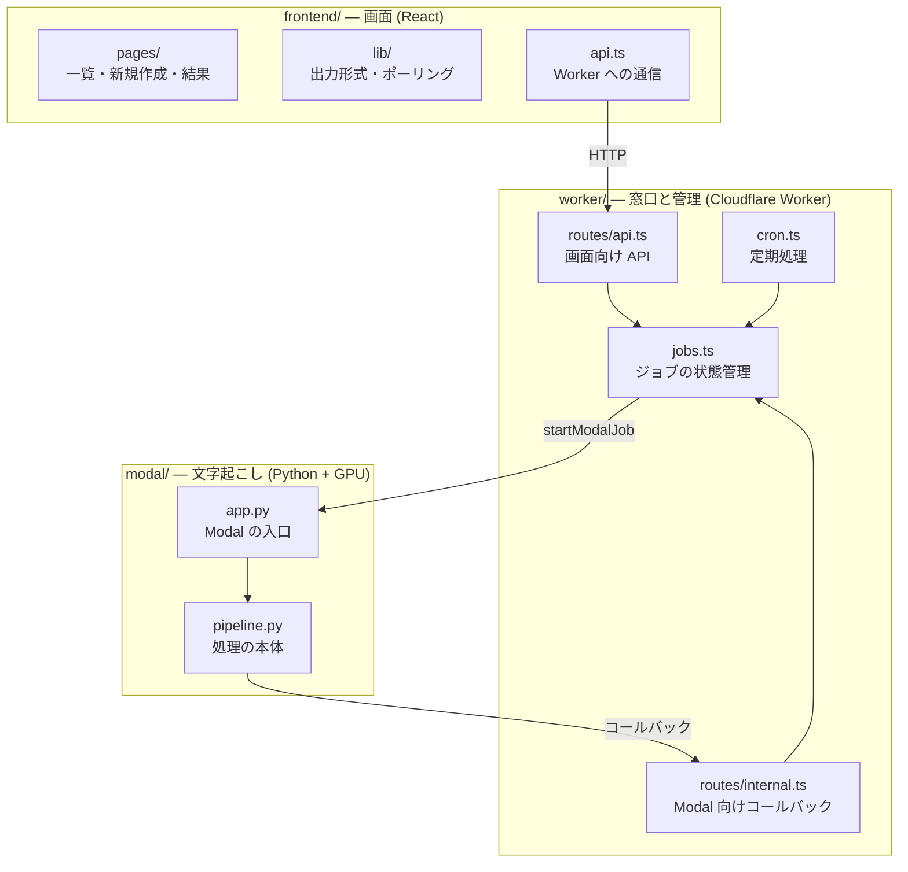

# 01 全体構成

**このファイルで分かること**: 登場する部品の役割、その技術を選んだ理由、フォルダとコードの対応。
**前提**: [README.md](README.md)。用語は [glossary.md](glossary.md)。

## 3つの部品とその役割

このアプリは大きく3つのフォルダに分かれます。

**図の読み方**: 画面は Worker にだけ話しかけます。Worker は状態を管理し、重い処理を Modal に任せます。Modal は終わったら Worker に報告します。

| 部品 | 役割 | たとえ |
|---|---|---|
| frontend | 操作画面を表示する | 受付カウンター |
| worker | 依頼を受け、状態を記録し、Modal を起動する | 受付係兼・進行管理 |
| modal | 音声を文字にする(GPU が必要な重い仕事) | 作業場 |
| D1 | ジョブの状態を記録する | 台帳 |
| R2 | 音声と結果を置く | 倉庫 |

## 技術選定の理由

| 技術 | 選んだ理由 |
|---|---|
| Cloudflare Workers + Static Assets | 画面(静的ファイル)と API を**同じ URL(同一オリジン)**で配信でき、無料枠が広い。[wrangler.jsonc](../../worker/wrangler.jsonc) の `assets` で設定 |
| Hono | Worker 上で動く軽量なルーティング。コードが短くなる |
| D1 | ジョブが1人分で小規模。SQL で「この状態のジョブだけ」を安全に更新できる |
| R2 | 大きな音声を置ける。**外へ出る通信料が無料**。署名付き URL でブラウザ・Modal が直接やり取りできる |
| Cron Triggers | Modal からの連絡が途絶えたジョブを拾う安全網に必要 |
| Cloudflare Access | 自前でログインを作らず、自分だけに限定できる |
| Modal | GPU を使った分だけ課金。無料クレジットの範囲で個人利用できる |
| faster-whisper large-v3 | 日本語の精度が高く、GPU で速い |
| pyannote | 話者分離の定番。単語ごとの時刻と組み合わせられる |
| Discord Webhook | URL に POST するだけで通知でき、アカウント連携が不要 |

## なぜ音声を Worker に通さないのか

Worker には処理時間とメモリの制限があり、300MB のファイルを中継するのに向きません。そこで **署名付き URL** で、ブラウザから R2 へ直接アップロードします。Modal も同じ方法で R2 から音声を取得するので、**Modal に R2 の鍵を渡さずに済みます**(詳細は [09](09-security.md))。

## ディレクトリとコードの対応

| 場所 | 中身 | 詳細 |
|---|---|---|
| [frontend/src/pages/](../../frontend/src/pages/) | 3つの画面 | [08](08-frontend.md) |
| [frontend/src/lib/](../../frontend/src/lib/) | 出力形式、ポーリング、表示用ラベル | [08](08-frontend.md) |
| [worker/src/routes/](../../worker/src/routes/) | `api.ts`(画面向け)、`internal.ts`(Modal 向け) | [07](07-api-reference.md) |
| [worker/src/jobs.ts](../../worker/src/jobs.ts) | ジョブの作成・状態遷移 | [02](02-job-lifecycle.md) |
| [worker/src/cron.ts](../../worker/src/cron.ts) | 定期処理 | [06](06-cron-and-cleanup.md) |
| [worker/src/r2.ts](../../worker/src/r2.ts) | 署名付き URL の発行、R2 のキー名 | [03](03-upload-flow.md) |
| [worker/src/modal.ts](../../worker/src/modal.ts) | Modal の起動 | [05](05-callback-and-notification.md) |
| [worker/src/access.ts](../../worker/src/access.ts), [hmac.ts](../../worker/src/hmac.ts) | 認証・署名の検証 | [09](09-security.md) |
| [worker/src/discord.ts](../../worker/src/discord.ts) | 通知 | [05](05-callback-and-notification.md) |
| [worker/src/validation.ts](../../worker/src/validation.ts) | 入力の検証ルール(zod) | [07](07-api-reference.md) |
| [worker/migrations/](../../worker/migrations/0001_create_jobs.sql) | D1 の表の定義 | [10](10-data-and-storage.md) |
| [modal/app.py](../../modal/app.py) | Modal の関数定義 | [04](04-transcription-pipeline.md) |
| [modal/pipeline.py](../../modal/pipeline.py) | 文字起こしの本体 | [04](04-transcription-pipeline.md) |

## リクエストを受け取る入口(Worker)

[worker/src/index.ts](../../worker/src/index.ts) が入口です。

| 入口 | 処理 |
|---|---|
| `fetch`(HTTP) | `/api/*` は先に `requireAccess` を通してから `api` へ。`/internal/*` は Access を通さず `internal` へ |
| `scheduled`(Cron) | `handleScheduled(event.cron, env)` へ([06](06-cron-and-cleanup.md)) |

[wrangler.jsonc](../../worker/wrangler.jsonc) の `run_worker_first: ["/api/*", "/internal/*"]` により、この2つのパスは必ず Worker が処理し、それ以外は画面のファイルを返します(存在しないパスは画面の `index.html`、SPA)。

## 関連ファイル

- 次に読む: [02-job-lifecycle.md](02-job-lifecycle.md) — 部品をまたいで1件のジョブがどう進むか
- [09-security.md](09-security.md) — 部品同士の信頼の仕組み
