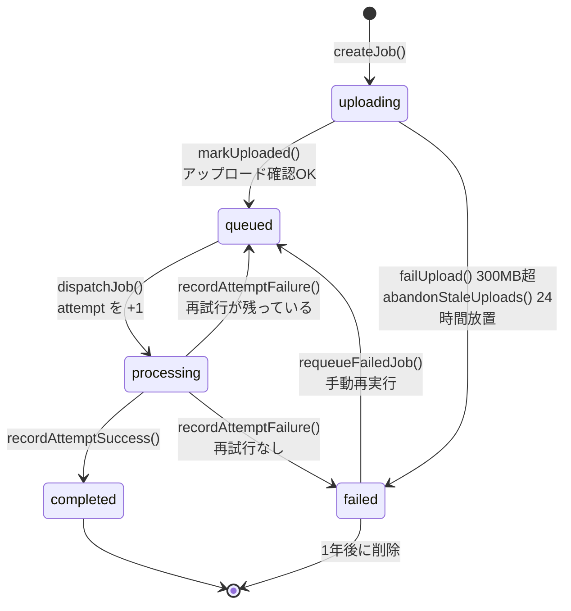
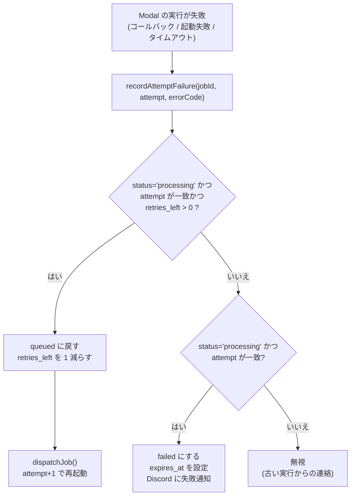

# 02 ジョブの一生(状態遷移)

**このファイルで分かること**: ジョブの5つの状態、失敗したときの再試行、手動再実行、D1 の各列の意味。
**前提**: [01-system-overview.md](01-system-overview.md)。

「ジョブ」は1本の音声に対する依頼で、D1 の `jobs` テーブルの1行です。状態を管理するコードは [worker/src/jobs.ts](../../worker/src/jobs.ts) に集まっています。

## 状態遷移図

**図の読み方**: 箱が状態、矢印が遷移で、矢印の下は遷移を起こす関数です。`processing → queued` が「自動再試行」、`failed → queued` が「手動再実行」です。

| 状態 | 意味 | 画面の表示 |
|---|---|---|
| `uploading` | ジョブは作ったが、音声がまだ届いていない | アップロード中 |
| `queued` | 音声が届き、Modal の起動待ち(ごく短時間) | 待機中 |
| `processing` | Modal が処理中 | 処理中 |
| `completed` | 結果が R2 に保存された | 完了 |
| `failed` | 失敗した(理由は `error_code`) | 失敗 |

## 状態を変える関数

状態の更新はすべて `UPDATE ... WHERE status = '〜'` の形です。**期待する状態のときだけ更新される**ので、同じ操作が2回来ても(二重送信、再送)1回しか効きません。

| 遷移 | 関数 | ファイル | 備考 |
|---|---|---|---|
| (新規) → uploading | `createJob` | [jobs.ts:51](../../worker/src/jobs.ts#L51) | `retries_left` を 2 に |
| uploading → queued | `markUploaded` | [jobs.ts:87](../../worker/src/jobs.ts#L87) | R2 上の実サイズを記録 |
| uploading → failed | `failUpload` | [jobs.ts:96](../../worker/src/jobs.ts#L96) | `file_too_large`。Discord 通知 |
| queued → processing | `dispatchJob` | [jobs.ts:120](../../worker/src/jobs.ts#L120) | `attempt + 1`、Modal 起動 |
| processing → completed | `recordAttemptSuccess` | [jobs.ts:180](../../worker/src/jobs.ts#L180) | 結果の存在確認後、音声削除 |
| processing → queued / failed | `recordAttemptFailure` | [jobs.ts:148](../../worker/src/jobs.ts#L148) | 再試行の有無で分岐 |
| failed → queued | `requeueFailedJob` | [jobs.ts:108](../../worker/src/jobs.ts#L108) | `retries_left` を 2 に戻す |
| uploading → failed (放置) | `abandonStaleUploads` | [cron.ts:59](../../worker/src/cron.ts#L59) | `upload_abandoned` |

## 失敗と再試行の流れ

**図の読み方**: 失敗が報告されるたび、まず再試行できるかを確認します。再試行を使い切ると `failed` になって通知します。`attempt` が合わない連絡は「古い実行のもの」なので捨てます。

- 自動再試行は **2回**(最初の1回と合わせて最大3回実行)。`MAX_AUTO_RETRIES = 2`([jobs.ts:8](../../worker/src/jobs.ts#L8))。
- 失敗の入口は3つあります。
  1. Modal からの失敗コールバック([05](05-callback-and-notification.md))
  2. Modal を起動できなかった(`dispatchJob` の `catch` → `modal_start_failed`)
  3. コールバックが届かないままの時間切れ(Cron → `timeout`、[06](06-cron-and-cleanup.md))
- 成功したのに結果ファイルが R2 に無い場合も `result_missing` として失敗扱い(再試行されます)。

### attempt が必要な理由(具体例)

1. 1回目の実行(`attempt=1`)が遅れ、75分で Cron が `timeout` 扱いにして2回目(`attempt=2`)を起動した。
2. そこへ1回目の古いコールバックが「完了」と届いた。
3. `attempt` が現在の 2 と一致しないので無視される。これにより、古い連絡が新しい実行の状態を壊しません([internal.ts:36](../../worker/src/routes/internal.ts) 付近の `callback.stale_ignored`)。

`attempt` は手動再実行でも**戻しません**(増え続けるだけ)。戻すと古いコールバックと衝突するためです。一方 `retries_left` は手動再実行で 2 に戻します。

## 手動再実行

`failed` のジョブは、画面の **再実行** ボタンから `POST /api/jobs/:id/retry` で再開できます([api.ts:103](../../worker/src/routes/api.ts#L103))。

- 音声が R2 に残っている間(約24時間)だけ可能。無ければ `410 audio_expired`。
- `failed` 以外のジョブでは `409 not_failed`。
- 成功すると `requeueFailedJob` → `dispatchJob` で、新しい `attempt` で再開します。

## D1 `jobs` テーブルの各列

| 列 | 意味 | 例 |
|---|---|---|
| `id` | ジョブ ID(UUID)。R2 のキーにも使う | `3f2a…` |
| `filename` | 元のファイル名 | `第3回講義.mp3` |
| `size_bytes` | ファイルサイズ。アップロード確認時に R2 の実サイズで上書き | `52428800` |
| `status` | 5つの状態のどれか | `processing` |
| `attempt` | 何回目の実行か(単調増加) | `2` |
| `retries_left` | 残りの自動再試行回数 | `1` |
| `options` | 話者分離・話者数・用語リスト(JSON 文字列) | `{"diarization":true,…}` |
| `speaker_names` | 話者名の対応(JSON 文字列) | `{"SPEAKER_00":"田中"}` |
| `error_code` | 失敗理由の分類 | `timeout` |
| `duration_sec` | 音声の長さ(完了時) | `5400.0` |
| `created_at` / `started_at` / `completed_at` | 作成 / 今回の実行開始 / 完了の時刻(ISO 8601) | |
| `expires_at` | この行と結果を消す期限(完了・失敗から1年) | |

詳細は [10](10-data-and-storage.md)。

## エラーコード一覧

画面の文言は [labels.ts](../../frontend/src/lib/labels.ts) の `ERROR_LABELS` にあります。

| コード | 発生源 | 意味 |
|---|---|---|
| `file_too_large` | Worker / Modal | 300MB 超 |
| `upload_abandoned` | Cron | 24時間以内にアップロードが完了しなかった |
| `modal_start_failed` | Worker | Modal の起動に失敗(クレジット切れなど) |
| `download_failed` | Modal | R2 から音声を取得できない |
| `audio_decode_failed` | Modal | ffmpeg が読めない(壊れたファイル) |
| `transcription_failed` | Modal | Whisper の失敗 |
| `diarization_failed` | Modal | 話者分離の失敗(`HF_TOKEN` 未設定を含む) |
| `out_of_memory` | Modal | GPU メモリ不足 |
| `result_upload_failed` | Modal | 結果を R2 に保存できない |
| `result_missing` | Worker | 完了報告があるのに結果が無い |
| `timeout` | Cron | 75分たってもコールバックが無い |
| `internal_error` | Modal | 想定外の例外 |

## 関連ファイル

- 前: [01-system-overview.md](01-system-overview.md)
- [03-upload-flow.md](03-upload-flow.md) — `uploading → queued` の詳細
- [05-callback-and-notification.md](05-callback-and-notification.md) — `processing → completed/failed` の詳細
- [06-cron-and-cleanup.md](06-cron-and-cleanup.md) — 時間切れ・放置の検知
- [10-data-and-storage.md](10-data-and-storage.md) — テーブル定義の全体
