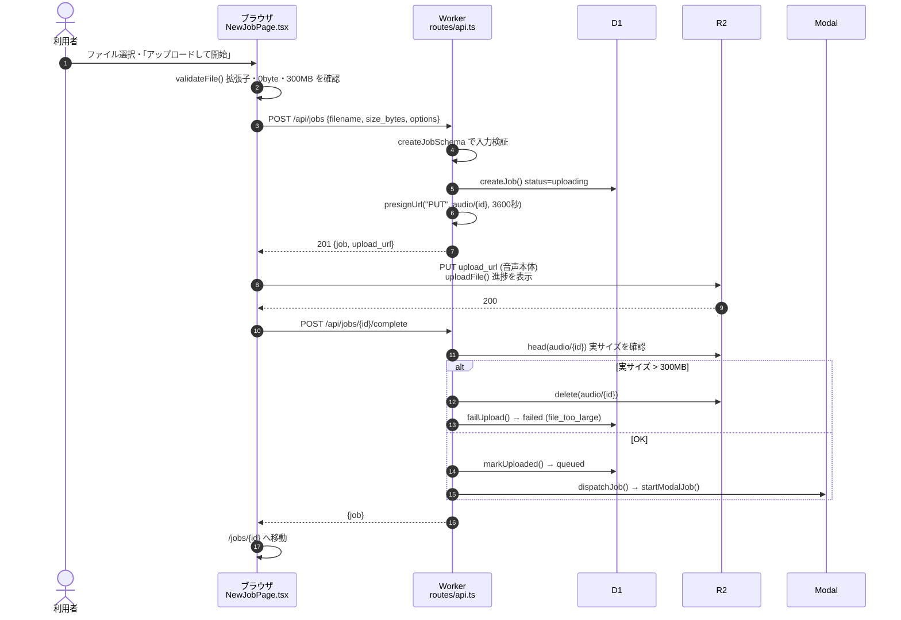

# 03 アップロードの流れ

**このファイルで分かること**: 音声がブラウザから R2 に届き、文字起こしが始まるまでの手順と、サイズ検証の仕組み。
**前提**: [02-job-lifecycle.md](02-job-lifecycle.md)。「署名付き URL」は [glossary.md](glossary.md) 参照。

## 一言で言うと

1. ブラウザが Worker に「ジョブを作って」と頼む → **アップロード専用の URL** をもらう。
2. ブラウザが、その URL に音声を**直接** PUT する(Worker を通らない)。
3. ブラウザが Worker に「送り終わった」と伝える → Worker が R2 を確認して Modal を起動する。

## シーケンス図

**図の読み方**: 3〜5 は「申し込み」、6〜7 が「音声本体の転送」、8 以降が「到着確認と開始」です。重い 6 だけが Worker を通らず R2 に直行します。

## コード対応表

| 処理 | ファイル | 関数・場所 |
|---|---|---|
| ファイルの事前チェック | [NewJobPage.tsx:10](../../frontend/src/pages/NewJobPage.tsx#L10) | `validateFile` |
| 送信ボタンの処理全体 | [NewJobPage.tsx:48](../../frontend/src/pages/NewJobPage.tsx#L48) | `onSubmit` |
| ジョブ作成 API 呼び出し | [api.ts:46](../../frontend/src/api.ts#L46) | `createJob`(フロント) |
| R2 へ直接 PUT(進捗付き) | [api.ts:70](../../frontend/src/api.ts#L70) | `uploadFile`(`XMLHttpRequest`) |
| アップロード完了の通知 | [api.ts:53](../../frontend/src/api.ts#L53) | `completeUpload` |
| 入力検証ルール | [validation.ts](../../worker/src/validation.ts) | `createJobSchema`, `MAX_UPLOAD_BYTES` |
| ジョブ作成 API | [api.ts:32](../../worker/src/routes/api.ts#L32) | `POST /jobs` |
| 署名付き URL の発行 | [r2.ts:11](../../worker/src/r2.ts#L11) | `presignUrl` |
| 完了通知 API | [api.ts:52](../../worker/src/routes/api.ts#L52) | `POST /jobs/:id/complete` |
| uploading → queued | [jobs.ts:87](../../worker/src/jobs.ts#L87) | `markUploaded` |

## ポイント解説

### 署名付き URL とは

`presignUrl()` は、R2 の鍵(`R2_ACCESS_KEY_ID` など)で URL に**署名**を付けます。この URL は

- **1つのファイル**(`audio/{ジョブID}`)だけ
- **1つの操作**(PUT = 書き込みだけ)だけ
- **期限付き**(アップロード用は `UPLOAD_URL_TTL_SEC` = 60分)

に使えます。鍵そのものはブラウザに渡らないので、URL が漏れても被害は限定的です。

### サイズ検証が3段階ある理由

| 段階 | 場所 | 目的 |
|---|---|---|
| 1. ブラウザ | `validateFile` | すぐに利用者へ知らせる(便利のため) |
| 2. Worker の入力検証 | `createJobSchema`(`size_bytes ≤ 300MB`、拡張子) | **申告値**の確認 |
| 3. 完了時 | `complete` が `BUCKET.head()` で**実サイズ**を確認 | 申告を偽って大きなファイルを送る場合を防ぐ |

ブラウザの検証は回避できるため、**信頼できるのは3の実サイズ確認**です。超過していれば音声を消して `file_too_large` で失敗にします。Modal 側の `download_audio` も、取得中に 300MB を超えたら打ち切ります([04](04-transcription-pipeline.md))。

### 二重送信への備え

`complete` が2回呼ばれても、`markUploaded()` は `WHERE status='uploading'` の更新なので 1回しか成功せず、Modal も1回しか起動しません(テスト: `does not start Modal twice on a duplicate completion`)。

### R2 の CORS

ブラウザが別オリジン(R2)に PUT するには、R2 側で許可が必要です。[worker/r2-cors.json](../../worker/r2-cors.json) が「アプリのオリジンからの `PUT` だけ許可」を定義しています([セットアップ](../setup/05-cloudflare.md))。

### 失敗の例

| 症状 | 原因 | 画面・API |
|---|---|---|
| 「対応していない形式です」 | 拡張子が mp3 / m4a / wav / mp4 / webm / ogg 以外 | ブラウザで即表示 |
| `upload_not_found`(409) | PUT が成功せず R2 に無いまま完了通知 | 画面にエラー |
| アップロード中にタブを閉じた | `beforeunload` で警告するが閉じると中断 | ジョブは `uploading` のまま、24時間後に `upload_abandoned` |

## 関連ファイル

- 前: [02-job-lifecycle.md](02-job-lifecycle.md)
- 次: [04-transcription-pipeline.md](04-transcription-pipeline.md) — 起動された Modal 側の処理
- [09-security.md](09-security.md) — 署名付き URL による権限分離
- [07-api-reference.md](07-api-reference.md) — `/api/jobs` と `/complete` の仕様
