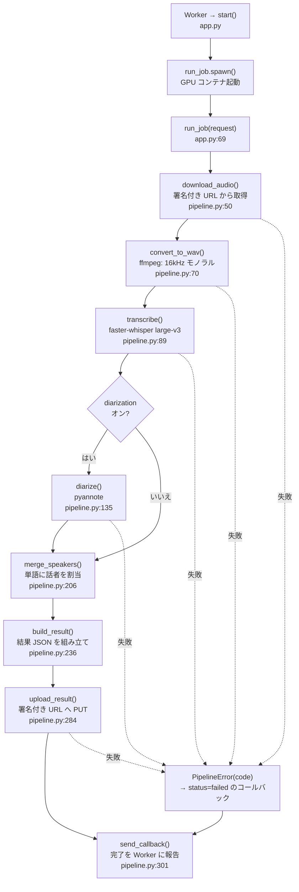
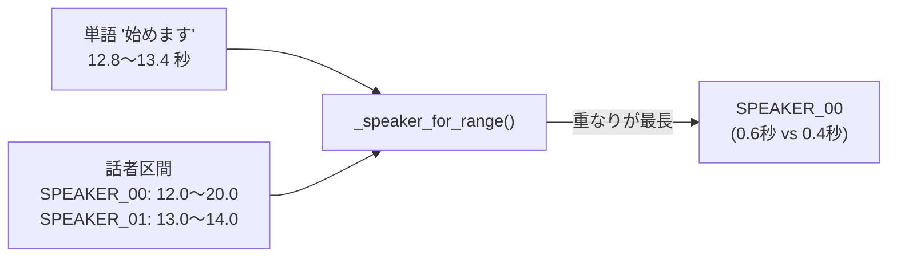

# 04 文字起こし処理(Modal)

**このファイルで分かること**: Modal 上で、音声がどう文字起こしされ、話者が割り当てられ、結果が保存されるか。
**前提**: [03-upload-flow.md](03-upload-flow.md)。Whisper・話者分離は [glossary.md](glossary.md)。

## 2つのファイルの役割

| ファイル | 役割 |
|---|---|
| [modal/app.py](../../modal/app.py) | **Modal 向けの設定**(GPU、タイムアウト、Volume、関数の登録) |
| [modal/pipeline.py](../../modal/pipeline.py) | **処理の本体**。Modal に依存せず、GPU なしで一部をテストできる |

`app.py` の関数:

| 関数 | 種類 | 内容 |
|---|---|---|
| `start` ([app.py:100](../../modal/app.py#L100)) | Web エンドポイント(POST、プロキシ認証必須) | Worker から呼ばれる。`run_job.spawn()` で GPU 関数を**起動だけして即返す** |
| `run_job` ([app.py:69](../../modal/app.py#L69)) | GPU 関数(T4、タイムアウト60分) | 1ジョブの処理。最後に Worker へコールバック |
| `transcribe_file` ([app.py:114](../../modal/app.py#L114)) | GPU 関数 | コマンドから1本だけ試す用 |
| `main` ([app.py:124](../../modal/app.py#L124)) | ローカル入口 | `modal run app.py::main` |

`start` が処理を待たず返すのは、Worker の待ち時間(30秒で打ち切り)に収めるためです。

## 全体フロー

**図の読み方**: 実線が成功の道、点線が失敗の道です。どこで失敗しても最後は必ず `send_callback()` に合流し、Worker に結果が伝わります。ここで `process_audio()` ([pipeline.py:251](../../modal/pipeline.py#L251)) が「ffmpeg → 文字起こし → 話者分離 → 結合」をまとめて担当します。

## 各ステップの解説

### 1. 音声の取得 — `download_audio`

署名付き URL(GET)から 1MB ずつ `/tmp` 配下の一時ディレクトリへ書き込みます。累計が 300MB を超えたら `file_too_large`、ステータスが 200 以外なら `download_failed`。例外メッセージに**署名付き URL が含まれるため、型名だけ**を残して投げ直します(ログ漏洩対策)。

### 2. 変換 — `convert_to_wav`

`ffmpeg -vn -ac 1 -ar 16000 -c:a pcm_s16le` を実行します。

| オプション | 意味 |
|---|---|
| `-vn` | 動画の映像を捨てる(mp4 / webm から音声だけ取る) |
| `-ac 1` | モノラルにする |
| `-ar 16000` | 16kHz にする(Whisper の標準) |

失敗は `audio_decode_failed`。

### 3. 文字起こし — `transcribe`

`faster-whisper` の `large-v3` を GPU(`float16`)で実行します。主な設定:

| 設定 | 値 | 理由 |
|---|---|---|
| `language` | `"ja"` 固定 | 自動判定を使わず安定させる |
| `word_timestamps` | `True` | 単語ごとの時刻が、話者の割り当てに必要 |
| `vad_filter` | `True` | 無音を飛ばして幻覚(ありもしない文)を減らす |
| `vad_parameters` | 既定値(`--vad-threshold` / `--vad-min-silence-ms` で変更可) | 小声やあいづちの取りこぼしを比べるため |
| `condition_on_previous_text` | `False`(`--context` で `True`) | 前の文に引きずられた繰り返しを防ぐ |
| `compression_ratio_threshold` | `2.4` | 同じ語の繰り返しになった結果をやり直す |
| `no_speech_threshold` | `0.6` | 発話がない区間を捨てる |
| `hallucination_silence_threshold` | `2.0` | 長い無音の前後の幻覚を飛ばす |
| `initial_prompt` | 用語を「、」でつないだ文 | 専門用語の認識を助ける |

モデルは `--model` で、ffmpeg の音量の正規化は `--normalize` で切り替えられます(いずれも `modal run` のみ)。

`model.transcribe()` はジェネレータで、`for` ループの中で実際に推論が進みます。5分ぶん進むごとに `whisper.progress` ログを出します。モデルの重みは Volume `whisper-models` にキャッシュされます([app.py:27](../../modal/app.py#L27))。

### 4. 話者分離 — `diarize`

pyannote の `speaker-diarization-community-1` を `HF_TOKEN` で読み込み、「`SPEAKER_00` が 12.3〜18.9 秒」といった**話者の区間(turn)**の一覧を作ります。`exclusive_speaker_diarization` を使うのは、同時発話を1人に絞った結果のほうが単語との対応付けに向くためです。`min_speakers` / `max_speakers` はヒントとして渡されます。

### 5. 話者の割り当て — `merge_speakers`

Whisper の単語と pyannote の区間を突き合わせます。

**図の読み方**: 単語と重なる話者区間の長さを話者ごとに合計し、**最も長い話者**を割り当てます。どの区間とも重ならなければ**最も近い区間**の話者になります([pipeline.py:177](../../modal/pipeline.py#L177))。

Whisper が返す日本語の単語は1文字単位で、文頭の1文字の開始時刻が実際より早く、直前の話者の区間に食い込むことがあります。そのため次の処理を入れています。

1. 単語の話者は、単語の**後半(中点〜終端)**だけで決める。
2. 同じ話者が続く区間のうち、**1秒未満かつ6文字未満**のものは、隣の長い区間の話者に吸収する(1文字だけ別の話者になるのを防ぐ)。
3. 話者が変わる位置でセグメントを分割する。
4. 同じ話者の隣り合うセグメントを、**間隔1.5秒以内・200文字以内**で1つの発言にまとめる。

話者分離がオフなら区間が空なので、`speaker` は `null` のままです。別人の発言を混ぜないよう、まとめる条件を厳しくし、**間隔0.5秒以内で、前の文が句点や「?」「!」で終わっておらず、200文字以内**のときだけ1つにします。定数は [pipeline.py](../../modal/pipeline.py) の `MIN_RUN_SEC` などです。

### 6. 結果の保存 — `build_result` と `upload_result`

[10](10-data-and-storage.md) のスキーマの JSON を組み立て、署名付き URL(PUT)で R2 の `results/{job_id}.json` に保存します。失敗は `result_upload_failed`。

### 7. 報告 — `send_callback`

成功・失敗にかかわらず Worker に報告します。詳細は [05](05-callback-and-notification.md)。

## エラーの扱い

`run_job` は 3 種類の例外を分けて受けます。

| 例外 | コールバックの内容 |
|---|---|
| `PipelineError(code)` | `status=failed`, `error_code=code` |
| それ以外の例外 | `status=failed`, `error_code=internal_error` |
| 正常終了 | `status=completed`, `duration_sec` |

`out of memory` を含む GPU エラーは `out_of_memory` に分類されます(`_classify_gpu_error`)。

## コード対応表

| 処理 | ファイル | 関数 |
|---|---|---|
| 設定値(モデル名など) | [pipeline.py:17](../../modal/pipeline.py#L17) | `WHISPER_MODEL`, `DIARIZATION_MODEL`, `LANGUAGE` |
| GPU・タイムアウト | [app.py:18](../../modal/app.py#L18) | `GPU = "T4"`, `FUNCTION_TIMEOUT_SEC = 3600` |
| 同時実行の上限 | [app.py:68](../../modal/app.py#L68) | `max_containers=2` |
| モデルキャッシュの保存 | [app.py:59](../../modal/app.py#L59) | `commit_model_cache` |
| 失敗理由の分類 | [pipeline.py:42](../../modal/pipeline.py#L42) | `PipelineError` |
| ログ(JSON 1行) | [pipeline.py:38](../../modal/pipeline.py#L38) | `log_event` |

## 関連ファイル

- 前: [03-upload-flow.md](03-upload-flow.md)
- 次: [05-callback-and-notification.md](05-callback-and-notification.md)
- [10-data-and-storage.md](10-data-and-storage.md) — 出力 JSON のスキーマ
- [11-testing.md](11-testing.md) — `merge_speakers` などのテスト
