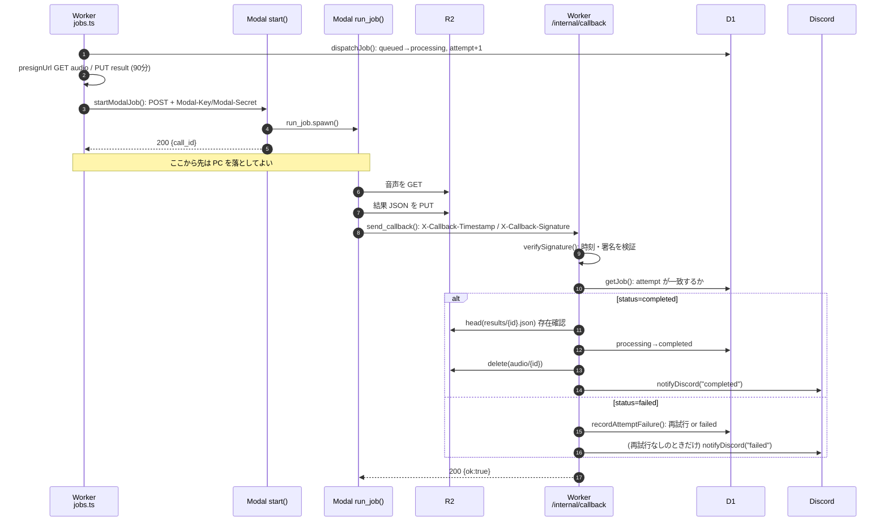
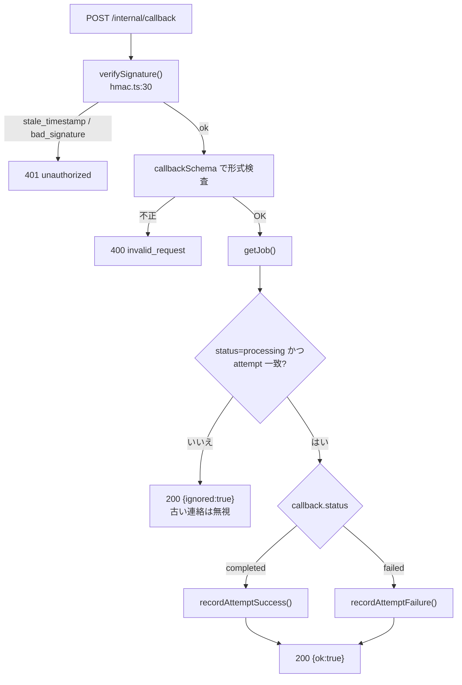

# 05 起動・コールバック・通知

**このファイルで分かること**: Worker が Modal を起動する方法、Modal が結果を報告する方法(HMAC 署名)、完了/失敗の処理、Discord 通知。
**前提**: [02-job-lifecycle.md](02-job-lifecycle.md)、[04-transcription-pipeline.md](04-transcription-pipeline.md)。

## 全体の流れ



**図の読み方**: 上半分が Worker → Modal の「起動」、下半分が Modal → Worker の「報告」です。報告のたびに署名・`attempt`・結果の存在を確認してから状態を変えます。

## 起動: `startModalJob`

[worker/src/modal.ts:15](../../worker/src/modal.ts#L15) は Modal の `start` エンドポイントに次を POST します。

```json
{
  "job_id": "3f2a…",
  "attempt": 1,
  "audio_url": "https://….r2.cloudflarestorage.com/…(GET, 90分)",
  "result_url": "https://….r2.cloudflarestorage.com/…(PUT, 90分)",
  "callback_url": "https://アプリのホスト/internal/callback",
  "options": { "diarization": true, "min_speakers": null, "max_speakers": null, "terms": [] }
}
```

- ヘッダ `Modal-Key` / `Modal-Secret`(Modal の Proxy Auth Token)で認証します。**これが無いと誰でも Modal を起動でき、クレジットを消費されます**。
- 30秒で応答が無ければ中断し、`modal_start_failed` として失敗扱い(再試行へ)。
- 署名付き URL は**実行のたびに作り直し**ます。再試行しても期限切れにならないためです。

## 報告: `send_callback`(Modal 側)

[pipeline.py:301](../../modal/pipeline.py#L301)。本文 JSON(例: `{"job_id":"…","attempt":1,"status":"completed","duration_sec":5400.0}`)に、署名ヘッダを付けて `callback_url` に POST します。

| ヘッダ | 中身 |
|---|---|
| `X-Callback-Timestamp` | 送信時刻(UNIX 秒) |
| `X-Callback-Signature` | `HMAC-SHA256(CALLBACK_SECRET, "<timestamp>.<本文>")` の16進文字列 |

**再送のルール**

| 応答 | 動作 |
|---|---|
| 2xx | 成功。終了 |
| 429 / 5xx / 通信エラー | `2^n` 秒(2, 4, 8, 16, 32秒)待って再送。最大6回 |
| 429 以外の 4xx | 再送しても変わらないので終了 |

再送のたびに**時刻を取り直して署名し直す**ため、古いリクエストとして弾かれません。6回失敗しても諦めますが、Worker の Cron がタイムアウトとして拾います([06](06-cron-and-cleanup.md))。

## 受信: `/internal/callback`(Worker 側)

[routes/internal.ts](../../worker/src/routes/internal.ts) の処理順です。



**図の読み方**: 上から順に関門があり、通過できた連絡だけが状態を変えます。無視する場合も 200 を返すのは、Modal に「もう送らなくてよい」と伝えるためです。

### HMAC 署名の検証 — `verifySignature`

[hmac.ts:30](../../worker/src/hmac.ts#L30)

1. 時刻が現在から **±300秒以内**か(古い通信の使い回し=リプレイを防ぐ)→ 外れたら `stale_timestamp`
2. 署名を 16進として読めるか → 読めなければ `bad_signature`
3. `"<timestamp>.<本文>"` を `CALLBACK_SECRET` で検証 → 不一致なら `bad_signature`

秘密を知っている Modal だけが正しい署名を作れるので、`/internal/callback` を Access の対象外にしても安全です([09](09-security.md))。

### 成功時: `recordAttemptSuccess`

[jobs.ts:180](../../worker/src/jobs.ts#L180)

1. R2 に `results/{id}.json` が**実際にあるか** `head` で確認(無ければ `result_missing` で失敗扱い)
2. `completed` に更新し、`expires_at` を1年後にする
3. 音声 `audio/{id}` を削除(失敗しても R2 のライフサイクルルールが1日で消す)
4. Discord に完了通知

「Modal が成功と言った」だけでは信用せず、**結果の存在を確かめてから**完了にします。

## Discord 通知

[discord.ts:19](../../worker/src/discord.ts#L19) の `notifyDiscord`。

| 種類 | メッセージ |
|---|---|
| 完了 | `✅ 文字起こしが完了しました` + ファイル名 + 結果ページのリンク |
| 失敗 | `❌ 文字起こしに失敗しました` + ファイル名 + 理由コード + リンク |

- 送るのは**成否・ファイル名・理由・リンクだけ**。本文は送りません。
- `allowed_mentions: { parse: [] }` で、ファイル名に `@everyone` があっても誰にも通知されないようにしています。
- 5秒で打ち切り、**例外を外に出さない**ので、Discord の障害でジョブの結果は変わりません(テスト: `does not let a Discord failure change the job result`)。
- `DISCORD_WEBHOOK_URL` が未設定なら通知を飛ばしてログだけ残します。
- 失敗通知は**再試行を使い切ったとき(と、アップロード時の `file_too_large`)だけ**です。再試行中は通知されません。

## コード対応表

| 処理 | ファイル | 関数 |
|---|---|---|
| Modal 起動 | [modal.ts:15](../../worker/src/modal.ts#L15) | `startModalJob` |
| 起動の前処理 | [jobs.ts:120](../../worker/src/jobs.ts#L120) | `dispatchJob` |
| Modal の受付口 | [app.py:100](../../modal/app.py#L100) | `start` |
| 署名の作成 | [pipeline.py:297](../../modal/pipeline.py#L297) | `sign_callback` |
| 報告と再送 | [pipeline.py:301](../../modal/pipeline.py#L301) | `send_callback` |
| 署名の検証 | [hmac.ts:30](../../worker/src/hmac.ts#L30) | `verifySignature` |
| コールバック受信 | [internal.ts:10](../../worker/src/routes/internal.ts#L10) | `POST /callback` |
| 完了/失敗の記録 | [jobs.ts:148](../../worker/src/jobs.ts#L148), [jobs.ts:180](../../worker/src/jobs.ts#L180) | `recordAttemptFailure`, `recordAttemptSuccess` |
| 通知 | [discord.ts:19](../../worker/src/discord.ts#L19) | `notifyDiscord` |

## 関連ファイル

- 前: [04-transcription-pipeline.md](04-transcription-pipeline.md)
- 次: [06-cron-and-cleanup.md](06-cron-and-cleanup.md) — コールバックが届かない場合の安全網
- [09-security.md](09-security.md) — HMAC・プロキシ認証の位置づけ
- [02-job-lifecycle.md](02-job-lifecycle.md) — 状態遷移の全体
