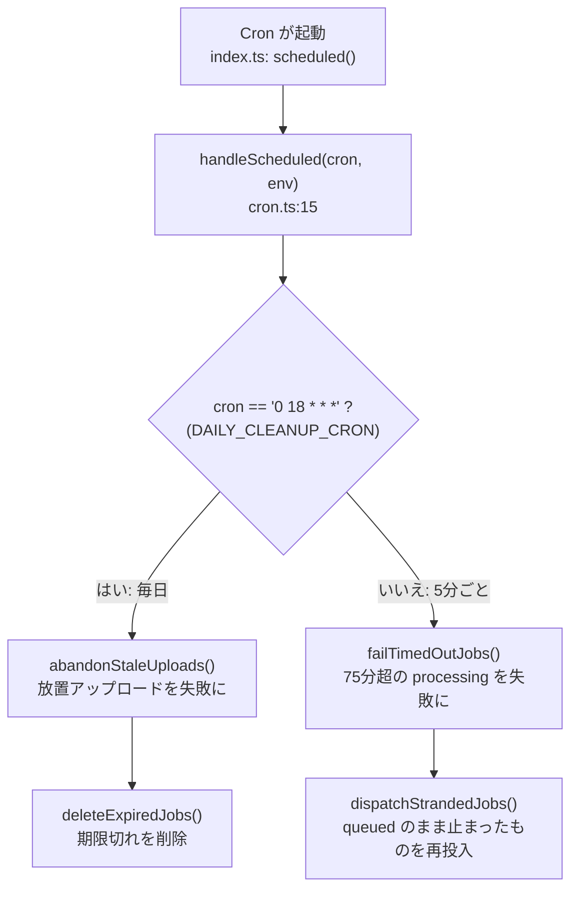

# 06 定期処理(Cron)と削除

**このファイルで分かること**: 時刻で自動的に動く2つの定期処理が何をするか、データがいつ消えるか。
**前提**: [02-job-lifecycle.md](02-job-lifecycle.md)、[05-callback-and-notification.md](05-callback-and-notification.md)。

## Cron とは

「5分ごと」「毎日3時」など、**決めた時刻に Worker を自動で起動する**仕組みです。このアプリでは、通常の流れが途中で止まった場合の**安全網**と、古いデータの**お掃除**に使います。

[wrangler.jsonc](../../worker/wrangler.jsonc) の定義:

```jsonc
"crons": ["*/5 * * * *", "0 18 * * *"]
```

| 式 | 意味 | 処理 |
|---|---|---|
| `*/5 * * * *` | 5分ごと | 時間切れの検知と、取りこぼしの再投入 |
| `0 18 * * *` | 毎日 18:00(UTC)= 翌 03:00 JST | 放置アップロードの整理と、期限切れデータの削除 |

## 振り分け



**図の読み方**: 起動した Cron の式を見て、毎日の掃除か5分ごとの見回りかを分けます。

## 4つの処理

| 関数 | 行 | 何を拾うか | どうするか |
|---|---|---|---|
| `failTimedOutJobs` | [cron.ts:28](../../worker/src/cron.ts#L28) | `processing` で `started_at` が **75分**以上前 | `recordAttemptFailure(…, "timeout")`。再試行が残っていれば再実行 |
| `dispatchStrandedJobs` | [cron.ts:47](../../worker/src/cron.ts#L47) | `queued` のまま残っているジョブ | `dispatchJob()` で再投入 |
| `abandonStaleUploads` | [cron.ts:59](../../worker/src/cron.ts#L59) | `uploading` で作成から **24時間**以上 | `failed`(`upload_abandoned`)に |
| `deleteExpiredJobs` | [cron.ts:70](../../worker/src/cron.ts#L70) | `expires_at` を過ぎた行(1回200件まで) | R2 の `results/{id}.json` と D1 の行を削除 |

### なぜ75分か

Modal 関数のタイムアウトは60分です。これに、起動待ちとコールバックの遅れの余裕15分を足した値です(`PROCESSING_TIMEOUT_MS`)。

### なぜ `dispatchStrandedJobs` が要るか

`markUploaded()`(→ `queued`)のあと `dispatchJob()` の前に Worker が止まると、`queued` のまま誰も Modal を起動しません。5分ごとに `queued` を探して再投入し、取りこぼしを防ぎます。`dispatchJob` は `WHERE status='queued'` の更新を取れた1回だけ Modal を起動するので、二重起動しません。

### 1件の失敗が全体を止めない

各ジョブの処理は `try/catch` で囲まれ、1件で例外が出ても残りの処理を続けます。

## データの保存期間

| 対象 | 期間 | 削除する主体 |
|---|---|---|
| 音声(成功時) | 完了直後 | Worker(`recordAttemptSuccess` が `BUCKET.delete`) |
| 音声(失敗時・放置時) | 約24時間 | **R2 のライフサイクルルール**(`audio/` を1日で削除) |
| 結果 JSON と D1 の行 | 完了/失敗から1年(`expires_at`) | Cron(`deleteExpiredJobs`) |

ライフサイクルルールは[セットアップ](../setup/05-cloudflare.md)で設定します。これが無いと、失敗時の音声が残り続けます。

`failed` のジョブも、`expires_at` が設定されるため1年後に削除されます。手動再実行(`requeueFailedJob`)では `expires_at` を `NULL` に戻します。

## ローカルで手動実行する

```sh
curl "http://localhost:8787/cdn-cgi/handler/scheduled?cron=*/5+*+*+*+*"   # 5分ごとの処理
curl "http://localhost:8787/cdn-cgi/handler/scheduled?cron=0+18+*+*+*"    # 毎日の処理
```

## 関連ファイル

- 前: [05-callback-and-notification.md](05-callback-and-notification.md)
- [02-job-lifecycle.md](02-job-lifecycle.md) — `timeout` / `upload_abandoned` の位置づけ
- [10-data-and-storage.md](10-data-and-storage.md) — `expires_at` と R2 のキー
- [../setup/08-local-dev.md](../setup/08-local-dev.md) — Cron の手動実行
