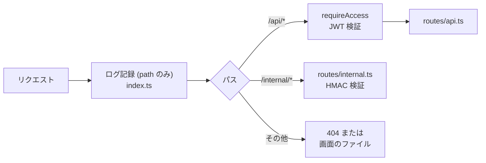

# 07 API リファレンス

**このファイルで分かること**: Worker が提供する全 API の使い方と、対応するコード。
**前提**: [02-job-lifecycle.md](02-job-lifecycle.md)。

## 共通事項

- ベースの URL はアプリと同じオリジン(画面と API は同一のホスト)。
- 本文は JSON(`Content-Type: application/json`)。
- 認証:
  - `/api/*` — **Cloudflare Access**。Worker が `Cf-Access-Jwt-Assertion` ヘッダの JWT を検証([access.ts](../../worker/src/access.ts))。無い/不正なら `401 {"error":"unauthorized"}`。
  - `/internal/*` — Access 対象外。**HMAC 署名**で検証([05](05-callback-and-notification.md))。
- エラーは `{"error": "<コード>"}` の形。想定外のエラーは `500 {"error":"internal_error"}`、未定義のパスは `404 {"error":"not_found"}`([index.ts](../../worker/src/index.ts))。



**図の読み方**: `/api` は JWT、`/internal` は HMAC と、パスごとに別の認証を通ります。

## エンドポイント一覧

| メソッド | パス | 認証 | 内容 | コード |
|---|---|---|---|---|
| POST | `/api/jobs` | Access | ジョブ作成+アップロード URL | [api.ts:32](../../worker/src/routes/api.ts#L32) |
| GET | `/api/jobs` | Access | 一覧(新しい順、最大200件) | [api.ts:40](../../worker/src/routes/api.ts#L40) |
| GET | `/api/jobs/:id` | Access | 1件の状態 | [api.ts:46](../../worker/src/routes/api.ts#L46) |
| POST | `/api/jobs/:id/complete` | Access | アップロード完了通知 | [api.ts:52](../../worker/src/routes/api.ts#L52) |
| GET | `/api/jobs/:id/result` | Access | 結果 JSON | [api.ts:78](../../worker/src/routes/api.ts#L78) |
| PATCH | `/api/jobs/:id/speakers` | Access | 話者名の保存 | [api.ts:93](../../worker/src/routes/api.ts#L93) |
| POST | `/api/jobs/:id/retry` | Access | 手動再実行 | [api.ts:103](../../worker/src/routes/api.ts#L103) |
| POST | `/internal/callback` | HMAC | Modal からの完了/失敗報告 | [internal.ts:10](../../worker/src/routes/internal.ts#L10) |

## 各 API の詳細

「ジョブ」オブジェクトは `toPublicJob()`([jobs.ts:30](../../worker/src/jobs.ts#L30))が作る形で、`options` と `speaker_names` は JSON として展開済みです([10](10-data-and-storage.md))。

### POST /api/jobs

リクエスト:

```json
{
  "filename": "第3回講義.mp3",
  "size_bytes": 52428800,
  "options": { "diarization": true, "min_speakers": null, "max_speakers": null, "terms": ["Whisper", "話者分離"] }
}
```

| 項目 | 検証(`createJobSchema`) |
|---|---|
| `filename` | 制御文字を除去、1〜255文字、拡張子が mp3 / m4a / wav / mp4 / webm / ogg |
| `size_bytes` | 正の整数、300MB(314,572,800)以下 |
| `options.diarization` | 真偽値、既定 `true` |
| `options.min_speakers` / `max_speakers` | 1〜32 または `null`。最小 ≤ 最大 |
| `options.terms` | 各1〜100文字、最大200語。既定は空 |

レスポンス `201`: `{ "job": {…, "status": "uploading"}, "upload_url": "https://…(署名付き PUT URL, 60分)" }`
エラー: 検証失敗 → `400 invalid_request`。

### GET /api/jobs, GET /api/jobs/:id

`{ "jobs": [ジョブ…] }` / `{ "job": ジョブ }`。存在しない ID は `404 not_found`。

### POST /api/jobs/:id/complete

本文なし。処理は [03](03-upload-flow.md) を参照。

| 状況 | 応答 |
|---|---|
| ジョブが無い | `404 not_found` |
| すでに `uploading` 以外 | `200 {job}`(何もしない) |
| R2 に音声が無い | `409 upload_not_found` |
| 実サイズが300MB超 | 音声削除+`failed`。`200 {job: failed}` |
| 正常 | `queued` → Modal 起動。`200 {job}`(多くは `processing`) |

### GET /api/jobs/:id/result

| 状況 | 応答 |
|---|---|
| `completed` でない | `409 not_completed` |
| R2 に結果が無い | `404 result_not_found` |
| 正常 | 結果 JSON をそのまま返す。`Cache-Control: private, no-store` |

### PATCH /api/jobs/:id/speakers

```json
{ "speaker_names": { "SPEAKER_00": "田中", "SPEAKER_01": "" } }
```

- キーは `SPEAKER_数字` の形のみ。値は最大100文字。
- **空文字の話者は保存しない**(名前を消す操作)。
- `completed` のジョブのみ更新可能。それ以外は `409 not_completed`。
- 正本の結果 JSON は書き換えません。

### POST /api/jobs/:id/retry

| 状況 | 応答 |
|---|---|
| `failed` でない | `409 not_failed` |
| 音声が R2 に無い(24時間経過) | `410 audio_expired` |
| 正常 | `queued` に戻して Modal を起動。`200 {job}` |

### POST /internal/callback

ヘッダ `X-Callback-Timestamp`, `X-Callback-Signature` が必須。

```json
{ "job_id": "3f2a…", "attempt": 1, "status": "completed", "duration_sec": 5400.0 }
```

```json
{ "job_id": "3f2a…", "attempt": 1, "status": "failed", "error_code": "audio_decode_failed" }
```

| 状況 | 応答 |
|---|---|
| 署名/時刻が不正 | `401 unauthorized` |
| 形式が不正(`error_code` は小文字と `_` の1〜64文字) | `400 invalid_request` |
| 古い実行・状態不一致 | `200 {ok:true, ignored:true}` |
| 正常 | `200 {ok:true}` |

## フロントエンドとの対応

| フロントの関数([api.ts](../../frontend/src/api.ts)) | 呼ぶ API |
|---|---|
| `listJobs` | `GET /api/jobs` |
| `getJob` | `GET /api/jobs/:id` |
| `createJob` | `POST /api/jobs` |
| `uploadFile` | (R2 の署名付き URL へ PUT。Worker の API ではない) |
| `completeUpload` | `POST /api/jobs/:id/complete` |
| `getResult` | `GET /api/jobs/:id/result` |
| `updateSpeakers` | `PATCH /api/jobs/:id/speakers` |
| `retryJob` | `POST /api/jobs/:id/retry` |

## 関連ファイル

- 前: [06-cron-and-cleanup.md](06-cron-and-cleanup.md)
- 次: [08-frontend.md](08-frontend.md) — API を使う側
- [09-security.md](09-security.md) — 認証の詳細
- [11-testing.md](11-testing.md) — API のテスト
