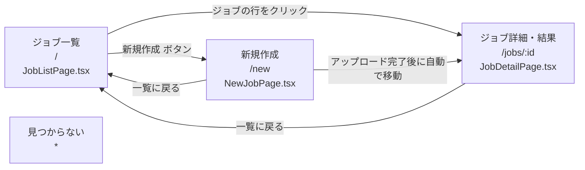
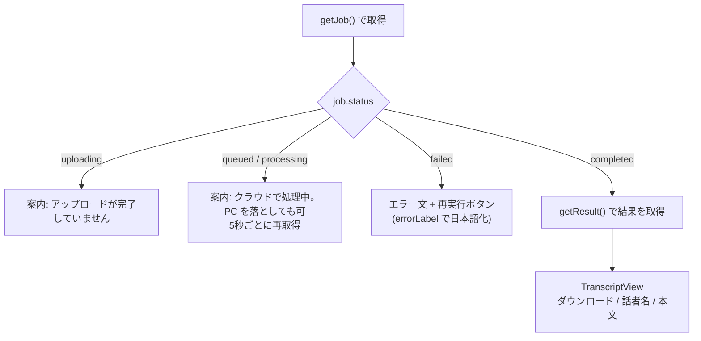
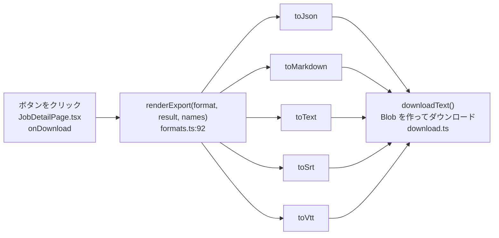
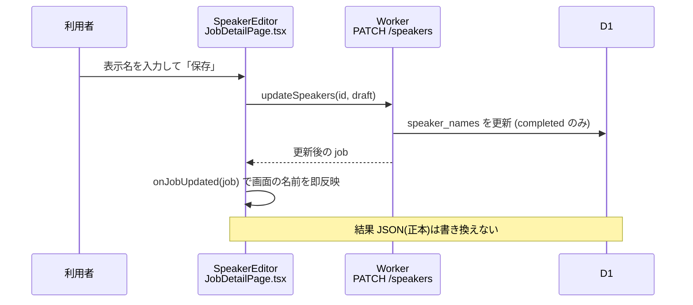

# 08 フロントエンド(画面)

**このファイルで分かること**: 3つの画面の構成、状態の自動更新(ポーリング)、5種類のダウンロード形式の作り方、話者リネーム。
**前提**: [07-api-reference.md](07-api-reference.md)。

画面は React(TypeScript)で作られ、[frontend/src/](../../frontend/src/) にあります。ビルドすると `frontend/dist/` になり、Worker が静的ファイルとして配信します。

## 画面遷移図

**図の読み方**: ルーティングは [main.tsx](../../frontend/src/main.tsx) の `Routes` で定義されています。ヘッダの「文字起こし」リンクからいつでも一覧に戻れます。

## 各画面

| 画面 | ファイル | 主な要素 | 呼ぶ API |
|---|---|---|---|
| 一覧 | [JobListPage.tsx](../../frontend/src/pages/JobListPage.tsx) | ジョブ行(ファイル名・日時・長さ・状態バッジ)、**新規作成**ボタン | `listJobs` |
| 新規作成 | [NewJobPage.tsx](../../frontend/src/pages/NewJobPage.tsx) | ファイル選択、話者分離チェック、最小/最大話者数、用語リスト、**アップロードして開始**ボタン、進捗バー | `createJob` → `uploadFile` → `completeUpload` |
| 詳細 | [JobDetailPage.tsx](../../frontend/src/pages/JobDetailPage.tsx) | 状態、案内文、**再実行**ボタン、ダウンロードボタン、話者名フォーム、本文 | `getJob`, `getResult`, `retryJob`, `updateSpeakers` |

共通部品: `StatusBadge`([components.tsx](../../frontend/src/components.tsx))は状態を色付きの札で表示します。

## 詳細画面の状態ごとの表示

**図の読み方**: 状態によって表示が切り替わります。`completed` になったときだけ結果 JSON を取りに行きます。

## ポーリング(自動更新)

[usePolling.ts](../../frontend/src/lib/usePolling.ts) は、一定間隔で関数を呼ぶ仕組みです。

| 画面 | 間隔 | 動く条件 |
|---|---|---|
| 一覧 | 10秒 | `queued` / `processing` のジョブが1件でもある |
| 詳細 | 5秒 | そのジョブが `queued` / `processing` |

- タブが非表示(`document.hidden`)の間は問い合わせません。
- 処理中でなければ止まります。通知は Discord が担うので、ブラウザを閉じても処理は進みます。

## ダウンロード形式の生成

結果の JSON が**正本**です。他の形式は**ブラウザ内で**作ります(Worker の処理時間を使わないため)。

| 形式 | 関数 | 出力例 |
|---|---|---|
| JSON | `toJson`([formats.ts:40](../../frontend/src/lib/formats.ts#L40)) | 結果に `speaker_names` を足して整形 |
| Markdown | `toMarkdown`(:44) | `**田中** [00:12:34]` の見出し行+本文(話者が変わるたび) |
| TXT | `toText`(:67) | `[00:12:34] 田中: それでは始めます。` |
| SRT | `toSrt`(:73) | 連番+`00:00:12,340 --> 00:00:18,900`(カンマ区切り)+話者名付き本文 |
| VTT | `toVtt`(:84) | `WEBVTT` 見出し+`00:00:12.340 --> …`(ドット区切り)。`& < >` はエスケープ |

話者名は `speakerLabel()`(:28)が決めます。リネーム済みならその名前、未設定なら `SPEAKER_00` のまま、話者分離なし(`null`)なら話者名は出しません。ファイル名は元のファイル名の拡張子だけを変えたもの(`exportFilename`)。

## 話者リネーム

**図の読み方**: 名前は D1 に保存され、本文の表示とすべてのダウンロードに反映されます。元の結果ファイルは変わらないので、いつでも名前を直せます。

## エラー表示

[labels.ts](../../frontend/src/lib/labels.ts) の `requestErrorMessage()` が API のエラーを日本語に直します(401 → 「認証の有効期限が切れています」、`audio_expired` → 「音声の保存期間(24時間)が過ぎた…」など)。`errorLabel()` はジョブの `error_code` を日本語にします([02](02-job-lifecycle.md#エラーコード一覧))。

## コード対応表

| 処理 | ファイル | 場所 |
|---|---|---|
| ルーティング | [main.tsx](../../frontend/src/main.tsx) | `Routes` |
| API 通信の共通部 | [api.ts:14](../../frontend/src/api.ts#L14) | `request`, `ApiError` |
| 型定義(Job, Segment …) | [types.ts](../../frontend/src/types.ts) | |
| 詳細画面 | [JobDetailPage.tsx:14](../../frontend/src/pages/JobDetailPage.tsx#L14) | `JobDetailPage` |
| 結果表示 | [JobDetailPage.tsx:117](../../frontend/src/pages/JobDetailPage.tsx#L117) | `TranscriptView` |
| 話者名フォーム | [JobDetailPage.tsx:170](../../frontend/src/pages/JobDetailPage.tsx#L170) | `SpeakerEditor` |
| 時刻表示 | [formats.ts:16](../../frontend/src/lib/formats.ts#L16) | `formatClock`(`HH:MM:SS`) |
| ログ | [logger.ts](../../frontend/src/logger.ts) | 本文は出さない |

開発時は Vite が `/api` を `http://localhost:8787`(Worker)に転送します([vite.config.ts](../../frontend/vite.config.ts))。

## 関連ファイル

- 前: [07-api-reference.md](07-api-reference.md)
- [03-upload-flow.md](03-upload-flow.md) — 新規作成画面の裏側
- [10-data-and-storage.md](10-data-and-storage.md) — 結果 JSON の形
- [11-testing.md](11-testing.md) — `formats.test.ts`
