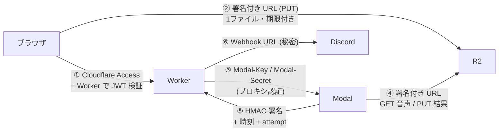
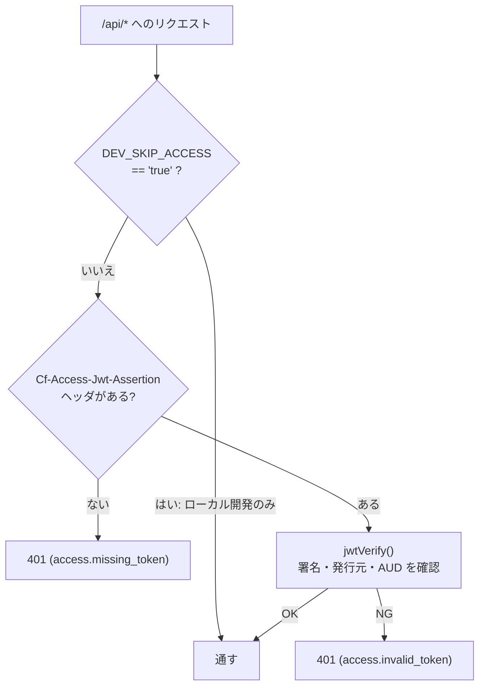

# 09 セキュリティ

**このファイルで分かること**: 「誰が」「何を」できるかをどう制限しているか。通信の経路ごとの守り方と、ログの方針。
**前提**: [03-upload-flow.md](03-upload-flow.md)、[05-callback-and-notification.md](05-callback-and-notification.md)。

## 全体像: 経路ごとに別の守り方

**図の読み方**: 矢印ごとに、**その経路専用の鍵**を使います。ひとつの鍵が漏れても、他の経路には影響しにくい設計です。

| 番号 | 経路 | 守り方 | 実装 |
|---|---|---|---|
| ① | ブラウザ → Worker | Access のログイン+Worker での JWT 検証 | [access.ts](../../worker/src/access.ts) |
| ② | ブラウザ → R2 | 署名付き URL(音声1ファイルの書き込みのみ、60分) | [r2.ts](../../worker/src/r2.ts) |
| ③ | Worker → Modal | Proxy Auth Token(`requires_proxy_auth=True`) | [modal.ts](../../worker/src/modal.ts), [app.py:99](../../modal/app.py#L99) |
| ④ | Modal → R2 | 署名付き URL(GET と PUT の2本、各90分) | [jobs.ts:120](../../worker/src/jobs.ts#L120) |
| ⑤ | Modal → Worker | HMAC 署名+±5分の時刻+`attempt` 照合 | [hmac.ts](../../worker/src/hmac.ts), [internal.ts](../../worker/src/routes/internal.ts) |
| ⑥ | Worker → Discord | Webhook URL を秘密にする | [discord.ts](../../worker/src/discord.ts) |

## ① Access と JWT の二重チェック

Cloudflare Access は、許可したメールアドレスの人だけを通すログイン門番です。**それだけに頼らず**、Worker 自身も JWT を検証します。

**なぜ二重か**: `workers.dev` など Access を通らない URL からも Worker は到達できてしまいます。その経路ではヘッダが無いため、Worker 側の検証で拒否できます。

- 発行元は `https://<ACCESS_TEAM_DOMAIN>`、対象は `ACCESS_AUD`。
- 公開鍵は `https://<team>/cdn-cgi/access/certs` から取得してキャッシュ。
- **`DEV_SKIP_ACCESS` は本番に設定してはいけません**(検証が無効になります)。[.dev.vars.example](../../worker/.dev.vars.example) はローカル専用です。

## ② ④ 署名付き URL による権限分離

Modal に R2 の API キーを**渡しません**。代わりに Worker がジョブごとに2本の URL を作って渡します。

| URL | 操作 | 対象 | 期限 |
|---|---|---|---|
| 入力用 | GET のみ | `audio/{job_id}` | 90分 |
| 出力用 | PUT のみ | `results/{job_id}.json` | 90分 |

- 期限 90分は、Modal のタイムアウト(60分)より**長く**してあります。処理中に切れないためです。
- Modal からは他のジョブのファイルも、削除も、できません。**音声の削除は Worker だけ**が行います。
- 万一 Modal 側から URL が漏れても、被害は「そのジョブの音声を読む/結果を書く」だけで、期限で失効します。

## ⑤ HMAC で偽の報告を防ぐ

`/internal/callback` は Access を通せません(Modal は人間ではないので)。代わりに共有の秘密 `CALLBACK_SECRET` で署名を確認します。

| 攻撃 | 防ぐもの |
|---|---|
| 第三者が「完了した」と偽の報告を送る | 署名が合わない → 401 |
| 過去の正しい通信を録っておいて再送する(リプレイ) | 時刻が±300秒を外れる → 401 |
| 本文を書き換える | 署名は本文を含む → 401 |
| 古い実行の報告で新しい実行を壊す | `attempt` が合わず無視 |

署名の比較は `crypto.subtle.verify`(定数時間)で行います。

## ログと通知の方針

- 文字起こし本文、署名付き URL、用語リスト、トークンは**ログに出さない**。ログは1行の JSON で、`job_id` や件数などの「メタ情報」だけ([logger.ts](../../worker/src/logger.ts) の冒頭コメント)。
  - 例: 入力検証エラーでは**項目名(パス)だけ**を記録し、値は記録しない。
  - 例: Modal の `download_audio` は、例外メッセージに URL が含まれるため型名だけ残す。
  - テスト `never logs signed URLs or user-supplied terms` が検証している。
- Discord には成否・ファイル名・理由コード・リンクだけ。
- R2 のパブリックアクセスは無効のまま。CORS は、アプリのオリジンからの `PUT` だけ許可([r2-cors.json](../../worker/r2-cors.json))。

## シークレット一覧

| 保存先 | 名前 | 用途 |
|---|---|---|
| Worker | `R2_ACCESS_KEY_ID` / `R2_SECRET_ACCESS_KEY` | 署名付き URL の発行(対象バケットのみ) |
| Worker | `MODAL_KEY` / `MODAL_SECRET` | Modal の呼び出し |
| Worker・Modal | `CALLBACK_SECRET` | コールバック署名(**同じ値**) |
| Worker | `DISCORD_WEBHOOK_URL` | 通知 |
| Modal | `HF_TOKEN` | 話者分離モデルの取得 |
| Worker(環境変数) | `ACCESS_TEAM_DOMAIN` / `ACCESS_AUD` | JWT の検証(秘密ではない) |

型は [env.ts](../../worker/src/env.ts)。登録手順は[セットアップ](../setup/README.md)。

## 残るリスク

処理中の音声は Modal の環境に存在します。人事や未公開情報など、機密性の高い会議はこのアプリで扱わない前提です。

## 関連ファイル

- 前: [08-frontend.md](08-frontend.md)
- [03-upload-flow.md](03-upload-flow.md), [05-callback-and-notification.md](05-callback-and-notification.md) — 各経路の流れ
- [../setup/06-access.md](../setup/06-access.md) — Access の設定手順
