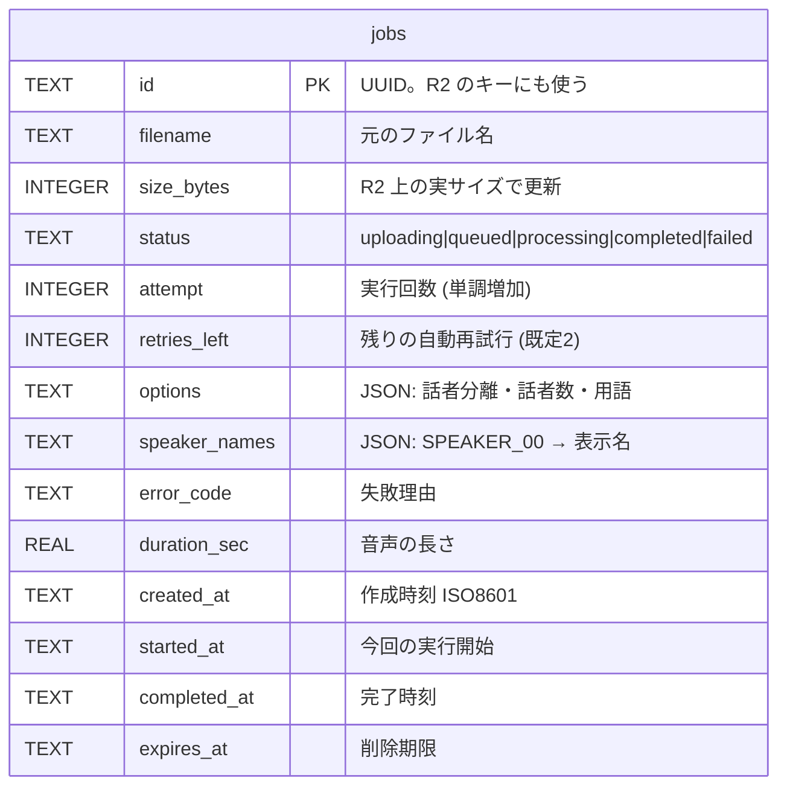

# 10 データと保存先

**このファイルで分かること**: D1 の表、R2 のファイル配置、結果 JSON の形。
**前提**: [02-job-lifecycle.md](02-job-lifecycle.md)。

## 保存先の使い分け

| 保存先 | 入れるもの | 理由 |
|---|---|---|
| D1(データベース) | ジョブの状態・設定・話者名など**小さな管理情報** | 条件付きの更新(`WHERE status=…`)が得意 |
| R2(ファイル置き場) | 音声と結果 JSON など**大きなファイル** | 大きなファイルを安く置ける |

## D1: `jobs` テーブル

定義: [worker/migrations/0001_create_jobs.sql](../../worker/migrations/0001_create_jobs.sql)



**図の読み方**: 表は `jobs` 1つだけです(個人用で、ユーザーなど他の表は不要)。各列の意味は [02](02-job-lifecycle.md#d1-jobs-テーブルの各列) を参照。

- インデックス: `idx_jobs_status`(Cron が状態で探す)、`idx_jobs_expires_at`(期限切れの検索)。
- 時刻は文字列(ISO 8601)で保存し、比較は文字列の大小で行えます。
- `options` の例: `{"diarization":true,"min_speakers":null,"max_speakers":null,"terms":["Whisper"]}`
- `speaker_names` の例: `{"SPEAKER_00":"田中"}`(初期値 `{}`)

### マイグレーション

表の作成は `wrangler d1 migrations apply` で適用します(`npm run db:migrate:local` / `db:migrate:remote`)。テストでは [vitest.config.ts](../../worker/vitest.config.ts) が同じ SQL を読み込んで適用します。

## R2: キー構造

[r2.ts](../../worker/src/r2.ts) の `audioKey` / `resultKey` が決めます。

```
whisper-files/                  ← バケット名
├── audio/
│   └── {job_id}                入力音声(拡張子なし)  成功後すぐ削除 / 失敗時は1日で自動削除
└── results/
    └── {job_id}.json           結果 JSON(正本)     1年後に削除
```

| 操作 | 誰が | いつ |
|---|---|---|
| `audio/{id}` を書く | ブラウザ(署名付き URL) | アップロード |
| `audio/{id}` を読む | Modal(署名付き URL) | 処理開始時 |
| `audio/{id}` を消す | Worker / R2 ライフサイクル | 完了直後 / 1日後 |
| `results/{id}.json` を書く | Modal(署名付き URL) | 処理終了時 |
| `results/{id}.json` を読む | Worker(`/result`) | 画面表示時 |
| `results/{id}.json` を消す | Worker(Cron) | 1年後 |

## 結果 JSON のスキーマ

Modal の `build_result()`([pipeline.py:236](../../modal/pipeline.py#L236))が作り、フロントの型 `TranscriptResult`([types.ts](../../frontend/src/types.ts))が読みます。

| 項目 | 型 | 意味 |
|---|---|---|
| `version` | 数値 | スキーマの版(現在 1) |
| `language` | 文字列 | 常に `"ja"` |
| `duration_sec` | 数値 | 音声の長さ(秒) |
| `model.transcription` | 文字列 | `"large-v3"` |
| `model.diarization` | 文字列 / `null` | 話者分離モデル名。オフなら `null` |
| `speakers` | 文字列の配列 | 登場した話者。オフなら `[]` |
| `segments[]` | 配列 | 発言のかたまり |
| `segments[].start` / `end` | 数値 | 開始・終了(秒、小数3桁) |
| `segments[].speaker` | 文字列 / `null` | 話者 |
| `segments[].text` | 文字列 | 本文 |
| `segments[].words[]` | 配列 | 単語ごとの `start` / `end` / `text` |

実例(話者分離オン):

```json
{
  "version": 1,
  "language": "ja",
  "duration_sec": 5400.0,
  "model": { "transcription": "large-v3", "diarization": "pyannote/speaker-diarization-community-1" },
  "speakers": ["SPEAKER_00", "SPEAKER_01"],
  "segments": [
    {
      "start": 12.34, "end": 18.9, "speaker": "SPEAKER_00",
      "text": "それでは始めます。",
      "words": [
        { "start": 12.34, "end": 12.8, "text": "それでは" },
        { "start": 12.8, "end": 13.4, "text": "始めます。" }
      ]
    }
  ]
}
```

実例(話者分離オフ): `"speakers": []`、`"model": {…, "diarization": null}`、各 `segment` の `"speaker": null`。

ダウンロードする JSON には、画面側で `speaker_names`(`{"SPEAKER_00":"田中"}`)が追加されます([08](08-frontend.md))。

## 関連ファイル

- 前: [09-security.md](09-security.md)
- [04-transcription-pipeline.md](04-transcription-pipeline.md) — JSON を作る処理
- [06-cron-and-cleanup.md](06-cron-and-cleanup.md) — 削除の仕組み
- [11-testing.md](11-testing.md)
