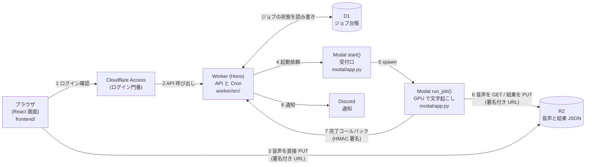
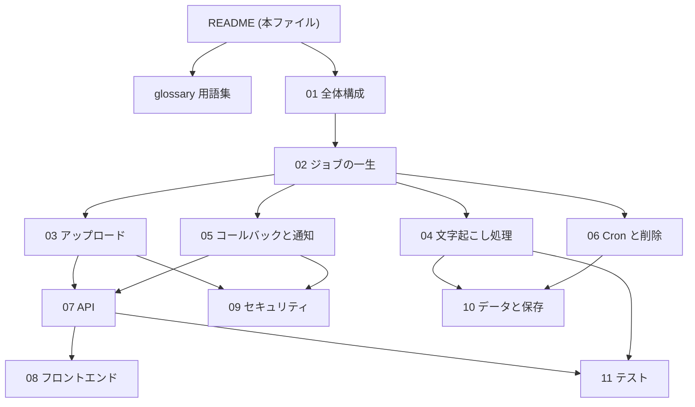

# 設計書 概要・読み方ガイド

最初にこのファイルを読んでください。どのファイルをどの順番で読めばよいかが分かります。

## このアプリは何をするか

- 長い日本語の音声(講義・会議、1本あたり約90分)を、**文字に起こす** Web アプリです。
- 「誰がいつ話したか」(話者分離)と、各発言の時刻(タイムスタンプ)も付きます。
- 音声をアップロードしたあとは、**PC の電源を落としても**クラウド側で処理が進みます。
- 終わると Discord に通知が届きます。結果は画面で読め、JSON / Markdown / TXT / SRT / VTT でダウンロードできます。
- 利用者は自分1人だけの個人用アプリです。

## システム全体図

**図の読み方**: 数字は処理の順番です。ブラウザは音声を Worker を通さず R2 へ直接送ります(3)。重い処理は Modal の GPU が行い(5〜6)、終わると Worker に知らせます(7)。

## 目的別の読み順

| 知りたいこと | 読む順番 |
|---|---|
| まず全体像をつかみたい | 本ファイル → [01](01-system-overview.md) → [02](02-job-lifecycle.md) |
| 用語が分からない | [glossary.md](glossary.md) |
| アップロードの仕組み | [03](03-upload-flow.md) → [09](09-security.md)(署名付き URL の節) |
| 文字起こしの中身(Whisper・話者分離) | [04](04-transcription-pipeline.md) → [10](10-data-and-storage.md)(結果 JSON) |
| 失敗・再試行・「終わらない」の調査 | [02](02-job-lifecycle.md) → [05](05-callback-and-notification.md) → [06](06-cron-and-cleanup.md) |
| API を呼ぶ・追加する | [07](07-api-reference.md) → [02](02-job-lifecycle.md) |
| 画面を直したい | [08](08-frontend.md) → [07](07-api-reference.md) |
| セキュリティを確認したい | [09](09-security.md) → [05](05-callback-and-notification.md) |
| データの保存場所・保存期間 | [10](10-data-and-storage.md) → [06](06-cron-and-cleanup.md) |
| テストを動かす・足す | [11](11-testing.md) |
| 環境を作りたい | [../setup/README.md](../setup/README.md) |

## ファイル一覧

難易度: ★ 初学者向け / ★★ 少しコードを読む / ★★★ コードを読みながら

| ファイル | 内容 | 主な対象コード | 難易度 |
|---|---|---|---|
| [glossary.md](glossary.md) | 用語集 | - | ★ |
| [01-system-overview.md](01-system-overview.md) | 構成要素の役割、技術選定の理由、ディレクトリ対応 | [package.json](../../package.json), [wrangler.jsonc](../../worker/wrangler.jsonc) | ★ |
| [02-job-lifecycle.md](02-job-lifecycle.md) | ジョブの状態遷移、再試行、手動再実行 | [worker/src/jobs.ts](../../worker/src/jobs.ts) | ★★ |
| [03-upload-flow.md](03-upload-flow.md) | アップロードの流れ、サイズ検証 | [api.ts](../../worker/src/routes/api.ts), [r2.ts](../../worker/src/r2.ts), [NewJobPage.tsx](../../frontend/src/pages/NewJobPage.tsx) | ★★ |
| [04-transcription-pipeline.md](04-transcription-pipeline.md) | Modal 内の文字起こし処理 | [modal/pipeline.py](../../modal/pipeline.py), [modal/app.py](../../modal/app.py) | ★★★ |
| [05-callback-and-notification.md](05-callback-and-notification.md) | 完了コールバック、HMAC、Discord 通知 | [internal.ts](../../worker/src/routes/internal.ts), [hmac.ts](../../worker/src/hmac.ts), [discord.ts](../../worker/src/discord.ts), [modal.ts](../../worker/src/modal.ts) | ★★★ |
| [06-cron-and-cleanup.md](06-cron-and-cleanup.md) | 定期処理、保存期間、削除 | [cron.ts](../../worker/src/cron.ts) | ★★ |
| [07-api-reference.md](07-api-reference.md) | 全 API の仕様 | [routes/](../../worker/src/routes/), [validation.ts](../../worker/src/validation.ts) | ★★ |
| [08-frontend.md](08-frontend.md) | 画面、ポーリング、出力形式、話者リネーム | [frontend/src/](../../frontend/src/) | ★★ |
| [09-security.md](09-security.md) | 認証、署名、権限分離、ログ方針 | [access.ts](../../worker/src/access.ts), [hmac.ts](../../worker/src/hmac.ts), [logger.ts](../../worker/src/logger.ts) | ★★ |
| [10-data-and-storage.md](10-data-and-storage.md) | D1 スキーマ、R2 のキー、結果 JSON | [migrations/](../../worker/migrations/0001_create_jobs.sql), [types.ts](../../frontend/src/types.ts) | ★★ |
| [11-testing.md](11-testing.md) | テストの場所と実行方法 | [worker/test/](../../worker/test/jobs.test.ts), [modal/tests/](../../modal/tests/test_pipeline.py) | ★★ |

## ファイル間の関係図

矢印は「先に読むと分かりやすい」順です。

## 設計書の使い方のコツ

- 各ファイルの冒頭に「このファイルで分かること」と「前提」、末尾に「関連ファイル」があります。迷ったら末尾のリンクをたどってください。
- 「コード対応表」の行番号は執筆時点の目安です。関数名で検索すると確実です。
- 計画段階の資料は [../plan.md](../plan.md) にあります。**計画とコードが違う場合は、コード(とこの設計書)が正**です。

## 関連ファイル

- [../setup/README.md](../setup/README.md): 環境構築の手順書
- [../../README.md](../../README.md): 開発コマンドの早見
