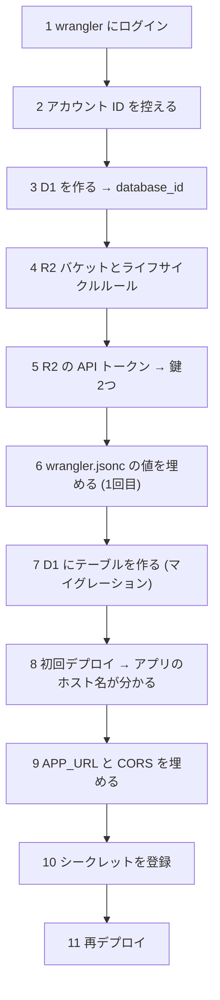

# 05 Cloudflare:D1・R2・Worker のセットアップとデプロイ

**ゴール**: データベース(D1)とファイル置き場(R2)を作り、Worker と画面を公開(デプロイ)する。
**前提**: [01](01-prerequisites.md)、[02](02-accounts.md)(Cloudflare)、[04](04-modal.md)(Modal の URL とトークン)、[07](07-discord.md)(Webhook URL)。
**仕組み**: [../architecture/01-system-overview.md](../architecture/01-system-overview.md)、[../architecture/10-data-and-storage.md](../architecture/10-data-and-storage.md)

公式: <https://developers.cloudflare.com/workers/>

> この手順では、アプリの URL に Cloudflare が自動で付ける `workers.dev` のホスト名(`whisper-transcriber.<サブドメイン>.workers.dev`)を使う前提で書いています。独自ドメインを使う場合は、そのホスト名に読み替えてください。
> 値を書き換える対象は [worker/wrangler.jsonc](../../worker/wrangler.jsonc) と [worker/r2-cors.json](../../worker/r2-cors.json) です。`REPLACE_WITH_…` と書かれた箇所が置き換え対象です。

## 全体の順番



**図の読み方**: アプリのホスト名は、一度デプロイしないと分かりません。そのため「1回目のデプロイ → ホスト名で設定 → 再デプロイ」の順になります。

## ステップ 1: wrangler にログインする

`wrangler` は Cloudflare の操作用コマンドです(`npm install` で入っています)。

**やること**

1. `worker` フォルダへ移動する。

```sh
cd ~/my_development/whisper/worker
```

2. ログインする。

```sh
npx wrangler login
```

3. ブラウザが開いたら、**Allow**(許可)ボタンをクリックする。

✅ **正常な場合**: ブラウザに「Successfully logged in(ログインしました)」と出て、ターミナルに次が出る。

```
Successfully logged in.
```

確認:

```sh
npx wrangler whoami
```

アカウント名とメールアドレス、**Account ID** の表が表示される。

❌ **異常な場合**

| 症状 | 対処 |
|---|---|
| ブラウザが開かない(WSL) | ターミナルの URL を手動でブラウザに貼る。リダイレクト先 `localhost:8976` に繋がらない場合は、ブラウザと wrangler が同じマシン上で動いているか確認 |
| `You are not authenticated` | `npx wrangler login` をやり直す |
| `npx: command not found` | Node.js が未導入([01](01-prerequisites.md)) |

## ステップ 2: アカウント ID を控える

**やること**: ステップ 1 の `npx wrangler whoami` の表にある **Account ID**(32桁の英数字)をコピーする。

または、ダッシュボードで: 左メニュー **Workers & Pages** をクリック → 右側の **Account ID** の横の **コピー** ボタンをクリック。

📝 **控える値**: アカウント ID → `wrangler.jsonc` の `R2_ACCOUNT_ID`。

## ステップ 3: D1(データベース)を作る

**やること**

```sh
npx wrangler d1 create whisper
```

✅ **正常な場合**

```
✅ Successfully created DB 'whisper' in region APAC
...
[[d1_databases]]
binding = "DB"
database_name = "whisper"
database_id = "<ここに表示される ID>"
```

表示された `database_id` をコピーし、[wrangler.jsonc](../../worker/wrangler.jsonc) の次の行を書き換える。

```jsonc
"database_id": "REPLACE_WITH_D1_DATABASE_ID",   // ← ここを置き換える
```

⚠️ wrangler が「wrangler.jsonc に追記しますか?」と尋ねたら、**No** を選び、手動で `database_id` だけ書き換えるのが安全です(既存の設定を壊さないため)。

❌ **異常な場合**

| 表示 | 対処 |
|---|---|
| `A database with that name already exists` | すでに作成済み。ダッシュボードの **Storage & databases → D1 SQL database**(表記は変わることがあります)で `whisper` の ID を確認する |
| `Authentication error` | ステップ 1 をやり直す |

## ステップ 4: R2 バケットとライフサイクルルールを作る

R2 はファイル置き場です。バケットは「フォルダのような入れ物」です。

**やること**

1. バケットを作る。

```sh
npx wrangler r2 bucket create whisper-files
```

✅ **正常な場合**

```
✅ Created bucket 'whisper-files' with default storage class set to Standard.
```

❌ **異常な場合**

| 表示 | 原因 | 対処 |
|---|---|---|
| `Please enable R2 through the Cloudflare Dashboard` | R2 が未有効化 | 下の「R2 を有効にする」を行う |
| `The bucket you tried to create already exists` | 作成済み | そのまま次へ |

**R2 を有効にする(上のエラーが出た場合)**

1. ダッシュボードの左メニュー **R2 Object Storage** をクリックする。
2. 案内に従って **Purchase R2 Plan**(または **Get started** / **Add R2 to my account**)のようなボタンをクリックする。
3. 支払い方法の登録を求められたら、画面の説明(無料枠の範囲と超過時の料金)を読んで判断する。無料枠: ストレージ 10GB-月、書き込み系 100万回/月、読み取り系 1000万回/月(公式: <https://developers.cloudflare.com/r2/pricing/>、2026-11-03 確認)。
4. 完了したら、上の `bucket create` をもう一度実行する。

> カード登録の要否は情報源で食い違いがありました。ダッシュボードの表示に従ってください。

2. 失敗時の音声を **1日で自動削除**するルールを付ける。

```sh
npx wrangler r2 bucket lifecycle add whisper-files delete-audio audio/ --expire-days 1
```

✅ **正常な場合**

```
✨ Adding lifecycle rule 'delete-audio' to bucket 'whisper-files'...
✨ Added lifecycle rule 'delete-audio' to bucket 'whisper-files'.
```

確認:

```sh
npx wrangler r2 bucket lifecycle list whisper-files
```

`delete-audio` が `audio/` に対して 1 日で期限切れになる、と表示されれば OK。

❌ **異常な場合**: `bucket not found` → バケット名のスペルを確認(`whisper-files`)。

## ステップ 5: R2 の API トークンを作る

Worker が「署名付き URL」を作るために必要な鍵です。**このバケットだけ**に権限を絞ります。

**やること**

1. ダッシュボードの左メニュー **R2 Object Storage**(または **R2**)をクリックする。
2. 画面右上、またはバケット一覧の上の **API**(または **Manage R2 API Tokens**)をクリックし、**Manage API tokens** を選ぶ。
3. **Create API token**(または **Create Account API token**)ボタンをクリックする。
4. **Token name** に `whisper-worker` と入力する。
5. **Permissions** で **Object Read & Write**(オブジェクトの読み取りと書き込み)を選ぶ。
6. **Specify bucket(s)**(バケットを指定)で `whisper-files` だけにチェックを入れる。
7. **Create API Token** ボタンをクリックする。
8. 表示された **Access Key ID** と **Secret Access Key** を、それぞれコピーして控える。

✅ **正常な場合**: 次の項目が表示される。**Secret Access Key は一度しか表示されません**。

```
Access Key ID:      <ここに値>
Secret Access Key:  <ここに値>
```

📝 **控える値**

| 値 | Worker でのシークレット名 |
|---|---|
| Access Key ID | `R2_ACCESS_KEY_ID` |
| Secret Access Key | `R2_SECRET_ACCESS_KEY` |

❌ **異常な場合**

| 症状 | 対処 |
|---|---|
| Secret を控え忘れた | トークンを削除(**Roll** で再発行も可)して作り直す |
| 後で `SignatureDoesNotMatch` | 鍵のコピーミス、または権限/バケット指定が違う。トークンを作り直す |
| **Admin** 権限で作ってしまった | 権限が広すぎる。Object Read & Write + バケット指定で作り直し、古いほうを削除 |

## ステップ 6: `wrangler.jsonc` の値を埋める(1回目)

[worker/wrangler.jsonc](../../worker/wrangler.jsonc) の `vars` を、次の表のとおり編集する。

| 項目 | 値 | この時点で |
|---|---|---|
| `R2_ACCOUNT_ID` | ステップ 2 のアカウント ID | 埋める |
| `R2_BUCKET_NAME` | `whisper-files` | そのまま |
| `MODAL_ENDPOINT_URL` | [04](04-modal.md) の `https://…--whisper-transcriber-start.modal.run` | 埋める |
| `APP_URL` | `https://<アプリのホスト>` | ステップ 9 で埋める |
| `ACCESS_TEAM_DOMAIN` / `ACCESS_AUD` | [06](06-access.md) で得る | 後で埋める |

✅ **正常な場合**: 埋めた箇所に `REPLACE_WITH_` が残っていない(`APP_URL` と `ACCESS_*` は後で埋める)。
`grep -n REPLACE_WITH wrangler.jsonc` で残りを確認できる。

❌ **異常な場合**: JSON の書式を壊す(カンマの付け忘れ、引用符の閉じ忘れ)と、デプロイ時に `Unexpected token` のようなエラーになります。値は `"` で囲み、行末のカンマを消さないでください。

## ステップ 7: D1 にテーブルを作る(マイグレーション)

**やること**

```sh
npm run db:migrate:remote
```

途中で `Ok to proceed?`(実行してよいか)と聞かれたら **y** を入力して Enter。

✅ **正常な場合**

```
Migrations to be applied:
 ┌────────────────────────┐
 │ name                   │
 ├────────────────────────┤
 │ 0001_create_jobs.sql   │
 └────────────────────────┘
...
│ 0001_create_jobs.sql │ ✅ │
```

❌ **異常な場合**

| 表示 | 原因 | 対処 |
|---|---|---|
| `Couldn't find a D1 DB with the name or binding 'whisper'` | `database_id` が未設定/誤り | ステップ 3 に戻る |
| `table jobs already exists` | すでに適用済み | 問題なし(再実行不要) |
| `Authentication error` | ログイン切れ | ステップ 1 |

## ステップ 8: 初回デプロイしてホスト名を知る

**やること**

1. リポジトリのルートに移動する。

```sh
cd ..
```

2. 画面をビルドして Worker とともにデプロイする。

```sh
npm run deploy
```

✅ **正常な場合**: 最後に公開 URL が表示される。

```
Uploaded whisper-transcriber (… sec)
Deployed whisper-transcriber triggers (… sec)
  https://whisper-transcriber.<サブドメイン>.workers.dev
  schedule: */5 * * * *
  schedule: 0 18 * * *
```

📝 **控える値**: `https://whisper-transcriber.<サブドメイン>.workers.dev` → これが**アプリのホスト**。

> この時点では Access が未設定で、`ACCESS_*` も空なので、画面を開くと API が `401` になるのは正常です。

❌ **異常な場合**

| 表示 | 原因 | 対処 |
|---|---|---|
| `tsc` の型エラーでビルド失敗 | コードや依存の問題 | エラー内容を確認。まず `npm run typecheck` |
| `Invalid database_id` | 置き換え忘れ | ステップ 3 |
| `You need to register a workers.dev subdomain` | workers.dev のサブドメインが未登録 | 案内に従い、サブドメイン名を入力して登録する(ダッシュボードの **Workers & Pages** → **Account details** からも設定可) |
| `Authentication error [code: 10000]` | ログイン切れ/権限不足 | ステップ 1 |

## ステップ 9: `APP_URL` と CORS を埋める

**やること**

1. [wrangler.jsonc](../../worker/wrangler.jsonc) の `APP_URL` を、`https://whisper-transcriber.<サブドメイン>.workers.dev` に書き換える(末尾の `/` は付けない)。
2. [r2-cors.json](../../worker/r2-cors.json) の `"https://REPLACE_WITH_APP_HOST"` を、**同じ `https://…workers.dev`** に書き換える。
3. CORS を R2 に反映する。

```sh
cd worker
npx wrangler r2 bucket cors set whisper-files --file r2-cors.json
```

✅ **正常な場合**

```
Setting CORS configuration (…) for 'whisper-files'...
✨ Set CORS configuration for 'whisper-files'.
```

確認: `npx wrangler r2 bucket cors list whisper-files` で許可オリジンが自分のホストになっている。

❌ **異常な場合**

| 症状 | 対処 |
|---|---|
| ブラウザのコンソールに `blocked by CORS policy` (アップロード時) | `r2-cors.json` のオリジンがアプリの URL と**完全一致**しているか確認(`https://`、末尾 `/` なし) |
| `Invalid CORS configuration` | JSON の書式を確認 |

## ステップ 10: シークレットを登録する

次の6つを1つずつ登録します。コマンドを実行すると値の入力を求められるので、貼り付けて Enter を押します(**入力は画面に表示されません**)。

| コマンド | 入れる値 | 出典 |
|---|---|---|
| `npx wrangler secret put R2_ACCESS_KEY_ID` | R2 の Access Key ID | ステップ 5 |
| `npx wrangler secret put R2_SECRET_ACCESS_KEY` | R2 の Secret Access Key | ステップ 5 |
| `npx wrangler secret put MODAL_KEY` | Modal の Token ID(`wk-…`) | [04](04-modal.md) |
| `npx wrangler secret put MODAL_SECRET` | Modal の Token Secret(`ws-…`) | [04](04-modal.md) |
| `npx wrangler secret put CALLBACK_SECRET` | **Modal に登録したものと同じ**64文字 | [04](04-modal.md) |
| `npx wrangler secret put DISCORD_WEBHOOK_URL` | Webhook URL | [07](07-discord.md) |

例:

```sh
npx wrangler secret put R2_ACCESS_KEY_ID
```

✅ **正常な場合**

```
✔ Enter a secret value: … ****************
🌀 Creating the secret for the Worker "whisper-transcriber"
✨ Success! Uploaded secret R2_ACCESS_KEY_ID
```

確認:

```sh
npx wrangler secret list
```

6つの名前が一覧に出る(値は表示されません)。

❌ **異常な場合**

| 症状 | 原因 | 対処 |
|---|---|---|
| `Worker not found` | まだデプロイしていない | ステップ 8 |
| 後で `callback.rejected: bad_signature` | `CALLBACK_SECRET` が Modal と**違う** | Modal 側(`modal secret create … --force`)か Worker 側を揃え直す |
| 値の末尾に改行/空白が入った | 貼り付け時の混入 | もう一度 `secret put` で上書き |

## ステップ 11: 再デプロイする

設定(`APP_URL` など)を反映します。

```sh
cd ..
npm run deploy
```

✅ **正常な場合**: ステップ 8 と同じ表示で `Deployed … triggers`。

> `ACCESS_TEAM_DOMAIN` / `ACCESS_AUD` は次の [06-access.md](06-access.md) で入れてから、もう一度 `npm run deploy` します。

## チェックリスト

- ☐ D1 `whisper` を作り、`database_id` を設定、マイグレーション適用済み
- ☐ R2 バケット `whisper-files` とライフサイクルルールがある
- ☐ R2 の API トークン(バケット限定)を作った
- ☐ `wrangler.jsonc` と `r2-cors.json` に `REPLACE_WITH_` が残っていない(`ACCESS_*` を除く)
- ☐ 6つのシークレットが登録されている
- ☐ `npm run deploy` が成功し、アプリのホストが分かった

## 次に読むファイル

- [06-access.md](06-access.md)
