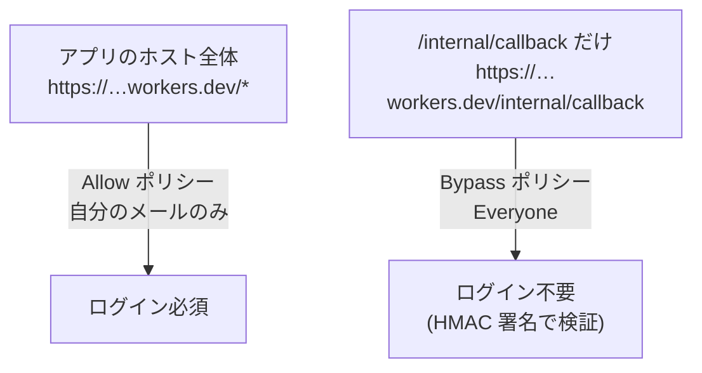

# 06 Cloudflare Access:ログインの保護

**ゴール**: アプリを「自分のメールアドレスの人だけ」に限定し、Modal からのコールバック(`/internal/callback`)だけは例外にする。さらに、Worker の JWT 検証用の値を設定する。
**前提**: [05-cloudflare.md](05-cloudflare.md) でデプロイ済みで、アプリのホストが分かっている。
**仕組み**: [../architecture/09-security.md](../architecture/09-security.md)

> ⚠️ Cloudflare Zero Trust の画面は変更が多い部分です。**画面表記は変わることがあります。**公式: <https://developers.cloudflare.com/cloudflare-one/applications/configure-apps/self-hosted-public-app/> と <https://developers.cloudflare.com/workers/configuration/cloudflare-access/>
> 2026-11-03 時点で、Workers の `workers.dev` に対して Access をワンクリックで有効化できることを公式の更新情報で確認しました。**ただし「ホスト全体を保護し、特定パスだけ例外にする」構成がその画面で作れるかは、本手順書では実機で確認できていません。**以下は「セルフホスト型アプリケーション」を手動で作る方法で書いています。

## このステップで作る2つの Access アプリケーション



**図の読み方**: ホスト全体をログイン必須にしつつ、より具体的なパス `/internal/callback` を別の Access アプリとして Bypass にします。Modal は人間ではなくログインできないためです。

## ステップ 1: Zero Trust を有効にする

**やること**

1. Cloudflare ダッシュボード(<https://dash.cloudflare.com>)の左メニューから **Zero Trust**(または **Cloudflare One**)をクリックする。
2. 初回は、チーム名(**Team name**)の入力を求められる。好きな英数字の名前(例: `mywhisper`)を入力する。
   - これが `mywhisper.cloudflareaccess.com` という**チームのドメイン**になる。
3. プラン選択画面が出たら **Free**(無料)を選び、案内に従って完了する。支払い方法の登録を求められる場合があります(無料プランなら課金されません)。

✅ **正常な場合**: Zero Trust のダッシュボード(左に **Access**、**Gateway** などのメニュー)が開く。

📝 **控える値**: チームのドメイン `<チーム名>.cloudflareaccess.com` → `ACCESS_TEAM_DOMAIN`。
後から確認する場所: Zero Trust の **Settings**(設定)→ **Custom pages** などに表示される team domain(画面により異なる)。

❌ **異常な場合**

| 症状 | 対処 |
|---|---|
| チーム名が使えない | 別の名前にする |
| メニューに Zero Trust が無い | アカウントのホーム画面を再読み込み。表記が **Cloudflare One** の場合あり |

## ステップ 2: ホスト全体を保護するアプリケーションを作る

**やること**

1. Zero Trust の左メニュー **Access**(または **Access controls**)→ **Applications** をクリックする。
2. **Add an application**(アプリケーションを追加)ボタンをクリックする。
3. **Self-hosted**(セルフホスト)を選ぶ。
4. **Application name** に `whisper`、**Session Duration** は好みの長さ(例: 24 hours)にする。
5. **Add public hostname**(公開ホスト名の追加)をクリックし、次を入力する。
   - **Input method**: `Default`
   - **Subdomain / Domain**: アプリのホスト(`whisper-transcriber.<サブドメイン>.workers.dev`)に対応する値を入力する。
   - **Path**: 空欄(ホスト全体)
   - 画面が **Domain** として `workers.dev` を選べない場合は、公式の「Workers の Access」(上のリンク)の手順で `workers.dev` 向けの有効化を使う。
6. **Next** をクリックし、ポリシー作成の画面へ進む。
7. **Policy name** に `only-me`、**Action** は **Allow** を選ぶ。
8. **Configure rules → Include** で **Selector: Emails**、**Value** に**自分のメールアドレス**を入力する。
9. **Next** → 他の設定はそのままで **Save**(または **Add application**)をクリックする。

✅ **正常な場合**: Applications 一覧に `whisper` が追加される。

📝 **控える値**: 作ったアプリを一覧からクリック → **Overview** タブにある **Application Audience (AUD) Tag**(64桁の英数字)の横の **コピー** をクリック → `ACCESS_AUD`。

❌ **異常な場合**

| 症状 | 原因 | 対処 |
|---|---|---|
| ホスト名の入力で `workers.dev` が選べない | `workers.dev` は自分のドメインではない扱い | 公式の「Cloudflare Access for Workers」(`workers.dev` のワンクリック有効化)を使う。AUD はその画面の **POLICY_AUD** と **TEAM_DOMAIN** に出る |
| 自分が弾かれる | メールの入力ミス | Policy の Include のメールを修正 |

## ステップ 3: `/internal/callback` を Bypass にする

**やること**

1. **Applications** → **Add an application** → **Self-hosted** を再度選ぶ。
2. **Application name** に `whisper-callback` と入力する。
3. **Add public hostname** で、ステップ 2 と**同じホスト**を入力し、**Path** に `internal/callback` を入力する(先頭の `/` は画面の指示に従う)。
4. ポリシーで **Policy name** を `bypass-callback`、**Action** を **Bypass** にする。
5. **Include → Selector: Everyone** を選ぶ。
6. **Save** をクリックする。

✅ **正常な場合**: Applications 一覧に `whisper-callback` が追加される。パスが具体的なほうが優先されるため、`/internal/callback` だけがログイン不要になる。

❌ **異常な場合**

| 症状 | 対処 |
|---|---|
| Bypass が選べない | **Action** の選択肢を確認。プランや画面で **Bypass** の名称が **Service Auth / Bypass** になっていることがある |
| コールバックが Access のログイン画面にリダイレクトされる | パスの指定がずれている。ログに `callback.rejected` ではなく **届いていない** ときはここを疑う |

> ⚠️ Bypass は `/internal/callback` **だけ**にしてください。ホスト全体を Bypass にすると誰でも API を使えます。コールバック自体は HMAC 署名で守られています([../architecture/09-security.md](../architecture/09-security.md))。

## ステップ 4: Worker に値を設定して再デプロイする

**やること**

1. [worker/wrangler.jsonc](../../worker/wrangler.jsonc) の `vars` を編集する。

```jsonc
"ACCESS_TEAM_DOMAIN": "<チーム名>.cloudflareaccess.com",
"ACCESS_AUD": "<ステップ 2 の AUD>",
```

- `ACCESS_TEAM_DOMAIN` は `https://` を付けても外しても動作しますが、既定の形式(`xxx.cloudflareaccess.com`)にそろえてください。

2. 再デプロイする。

```sh
cd ~/my_development/whisper
npm run deploy
```

✅ **正常な場合**: `Deployed whisper-transcriber triggers`。

## ステップ 5: 動作を確認する

**やること**

1. **ログインが必要か**: ブラウザの**シークレットウィンドウ**で `https://<アプリのホスト>/` を開く。
2. メールアドレス入力画面(Cloudflare Access)が出る。許可したメールアドレスを入力し、届いたワンタイムコードを入力する。
3. ログインできたら、**ジョブ一覧**画面(「ジョブ一覧」「新規作成」ボタン)が表示される。

✅ **正常な場合**: ログイン後にジョブ一覧が開く(「まだジョブはありません」と表示される)。

4. **API の保護**を確認する(ログインしていないターミナルから)。

```sh
curl -s -o /dev/null -w "%{http_code}\n" https://<アプリのホスト>/api/jobs
```

✅ **正常な場合**: `302`(ログイン画面へ転送)または `401`/`403`。**`200` なら保護されていません。**

5. **コールバックだけ通ること**を確認する。

```sh
curl -s -w "\n%{http_code}\n" -X POST https://<アプリのホスト>/internal/callback -H "Content-Type: application/json" -d '{}'
```

✅ **正常な場合**: `{"error":"unauthorized"}` と `401`(Worker まで届き、署名が無いので拒否された。Access の画面に飛ばされない)。

❌ **異常な場合**

| 表示 | 意味 | 対処 |
|---|---|---|
| 手順 4 が `200` | Access が掛かっていない | アプリのホスト名・パスの指定を確認 |
| 手順 5 が `302`/HTML | Bypass が効いていない | ステップ 3 を確認 |
| 画面で「認証の有効期限が切れています」 | JWT の検証に失敗(`ACCESS_AUD` / `ACCESS_TEAM_DOMAIN` の誤り) | ステップ 4 の値を確認し、再デプロイ。`npx wrangler tail` で `access.invalid_token` を確認 |
| 画面は開くが API が全部 `401`(`access.missing_token`) | Access を経由していない URL を使っている | Access で保護したホストの URL で開く |

> ⚠️ `DEV_SKIP_ACCESS` は**本番に設定しない**でください(`wrangler.jsonc` の `vars` にも `secret` にも入れない)。入れると JWT の検証が無効になります。

## チェックリスト

- ☐ ホスト全体が Allow(自分のメールのみ)で保護されている
- ☐ `/internal/callback` だけが Bypass
- ☐ `ACCESS_TEAM_DOMAIN` と `ACCESS_AUD` を設定して再デプロイした
- ☐ 未ログインの `/api/jobs` が `200` ではない
- ☐ 未署名の `/internal/callback` が `401`(Worker の応答)

## 次に読むファイル

- [09-verification.md](09-verification.md)
