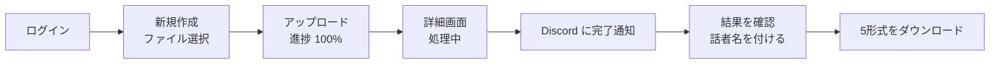

# 09 通し確認:最初の1本を流す

**ゴール**: 本番環境で、アップロード → 文字起こし → Discord 通知 → ダウンロードまで一通り動くことを確かめる。ログの見方も覚える。
**前提**: [04](04-modal.md)〜[07](07-discord.md) がすべて完了し、`npm run deploy` 済み。
**仕組み**: [../architecture/02-job-lifecycle.md](../architecture/02-job-lifecycle.md)

> 💡 最初は**短い音声(1〜3分)**で試すのがおすすめです。クレジットの消費が少なく、失敗しても原因を探しやすくなります。

## 通し確認の流れ



## ステップ 1: ログインしてジョブ一覧を開く

**やること**

1. ブラウザで `https://<アプリのホスト>/` を開く。
2. Access のログイン画面で、許可したメールアドレスを入力し、届いたコードを入力する。

✅ **正常な場合**: ヘッダに「文字起こし」、見出し「ジョブ一覧」、右上に **新規作成** ボタンが表示される。

❌ **異常な場合**: [10-troubleshooting.md](10-troubleshooting.md) の「画面を開くと…」の行を参照。

## ステップ 2: 新規作成

**やること**

1. 右上の **新規作成** ボタンをクリックする。
2. **音声ファイル** の「ファイルを選択」をクリックし、短い音声(mp3 / m4a / wav / mp4 / webm / ogg)を選ぶ。
3. 入力欄の下に、ファイルサイズ(例: `3.2 MB`)が表示されることを確認する。
4. **話者分離** のチェックを確認する(初回は入れたまま、会話の音声ならそのまま)。
   - チェックが入っていると **最小話者数** / **最大話者数** の入力欄が出る(空でもよい)。
5. 必要なら **用語リスト**(1行に1語)に、専門用語や固有名詞を入力する。
6. **アップロードして開始** ボタンをクリックする。

✅ **正常な場合**: 進捗バーが 0% → 100% と進み、「アップロード中 xx% ・ 完了まではこのタブを閉じないでください」と出る。100% になると自動的に詳細画面(`/jobs/<ID>`)に移動する。

❌ **異常な場合**

| 画面の表示 | 原因 | 対処 |
|---|---|---|
| ボタンが押せない(灰色) | ファイル未選択、または形式/サイズが不正 | 画面の赤いメッセージを読む(「対応していない形式です」「300MB を超えています」「ファイルが空です」) |
| 「話者数の最小は最大以下にしてください」 | 入力ミス | 数値を直す |
| 「リクエストに失敗しました(invalid_request)」 | 入力が検証に通らない | ファイル名(拡張子)や用語の長さ(各100文字まで・200語まで)を確認 |
| 進捗が 0% のまま/「通信に失敗しました」 | R2 への PUT が拒否された(CORS や鍵) | ブラウザの開発者ツール(F12)の **Console** と **Network** を確認。`CORS` → [05](05-cloudflare.md) ステップ 9。`403` → R2 の鍵(`R2_ACCESS_KEY_ID` など)を確認 |
| 「リクエストに失敗しました(upload_not_found)」 | R2 に音声が無い | もう一度アップロード |
| 「認証の有効期限が切れています」 | Access のセッション切れ | ページを再読み込みしてログインし直す |

## ステップ 3: 処理を見守る

**やること**

1. 詳細画面で状態バッジを見る。
2. 5秒ごとに自動更新される。

✅ **正常な場合**: 次のように変わる。

| 時間の目安 | バッジ | 案内文 |
|---|---|---|
| 直後 | 待機中 → **処理中** | 「クラウドで処理しています。このページを閉じても、PC の電源を落としても処理は続きます。完了すると Discord に通知します。」 |
| 数分〜(初回はモデルのダウンロードで長め) | **完了** | 本文とダウンロードボタンが現れる |

> 💡 この間は PC を閉じても構いません。確認のため、**ターミナルでログを見てもよい**(ステップ 6)。

❌ **異常な場合**

| 画面の表示 | 原因 | 対処 |
|---|---|---|
| **処理中** のまま75分以上 | Modal の停止/コールバック不達 | 75分を過ぎると Cron が自動で失敗にして再試行。ログで原因を確認 |
| **失敗**:「処理を開始できませんでした(Modal のクレジット切れの可能性があります)」 | `modal_start_failed`。Modal の URL/トークン不正、クレジット切れ | `MODAL_ENDPOINT_URL`、`MODAL_KEY`/`MODAL_SECRET` を確認。Modal の **Billing** を確認 |
| **失敗**:「話者分離に失敗しました」 | `HF_TOKEN` の誤り、利用条件に未同意 | [03](03-huggingface.md)、[04](04-modal.md) ステップ 3 |
| **失敗**:「音声ファイルを読み取れませんでした」 | 壊れたファイル/非対応コーデック | 別の音声で試す |
| **失敗**:「処理結果が保存されませんでした」「処理結果を保存できませんでした」 | R2 への結果の書き込み失敗 | 署名付き URL の期限/R2 の鍵を確認 |
| **失敗**: 画面の **再実行** ボタン | 自動再試行(最大2回)を使い切った状態 | 原因を直してから **再実行** をクリック(音声は約24時間残る) |

## ステップ 4: Discord の通知を確認する

✅ **正常な場合**: 完了すると通知用チャンネルに次が届く。

```
✅ 文字起こしが完了しました
ファイル: <ファイル名>
https://<アプリのホスト>/jobs/<ジョブID>
```

リンクをクリックすると結果の画面が開く。

❌ **異常な場合**: 通知が来ない(画面は完了している)

| 原因 | 対処 |
|---|---|
| `DISCORD_WEBHOOK_URL` が未登録 | ログに `discord.skipped_no_webhook`。[05](05-cloudflare.md) ステップ 10 |
| Webhook URL が無効 | ログに `discord.rejected`(status 404 など)。[07](07-discord.md) のテストで確認し、シークレットを入れ直す |
| 通知の失敗はジョブの結果に影響しません | 画面で結果は読めます |

## ステップ 5: 結果の確認とダウンロード

**やること**

1. 詳細画面の「ダウンロード」欄で、**JSON / Markdown / TXT / SRT / VTT** のボタンが並んでいることを確認する。
2. 「話者名」欄で、`SPEAKER_00` の横の **表示名** 欄に名前(例: 田中)を入力し、**保存** ボタンをクリックする。
3. 「保存しました」と出ることを確認する。本文の話者表示が名前に変わる。
4. **Markdown** ボタンをクリックしてダウンロードする。

✅ **正常な場合**

- 本文に `00:00:12` のような時刻と、話者名・文章が並ぶ。
- ダウンロードしたファイルの名前は「元のファイル名.md」。中身は次のような形。

```
**田中** [00:00:12]
それでは始めます。

**SPEAKER_01** [00:00:20]
お願いします。
```

❌ **異常な場合**

| 症状 | 対処 |
|---|---|
| 「音声から発話を検出できませんでした」 | 無音/声が小さい。別の音声で確認 |
| 話者名の保存で「リクエストに失敗しました(not_completed)」 | 完了前のジョブには保存できない |
| 話者が1人にしかならない | 話者数のヒント(最小/最大)を設定して再実行を試す(新しく作り直し) |

## ステップ 6: ログの見方

ログは1行の JSON で、`job_id` で絞り込めば Worker と Modal をまたいで1ジョブを追えます。**本文・署名付き URL・用語リストは出力されません。**

**Worker のログ**(別ターミナルで流しっぱなしにする)

```sh
cd ~/my_development/whisper/worker
npx wrangler tail
```

✅ **正常な場合**: リクエストのたびに JSON が流れる。

```
{"level":"info","event":"job.created","job_id":"…","size_bytes":3200000,"diarization":true,"term_count":0}
{"level":"info","event":"job.upload_verified","job_id":"…","size_bytes":3200000}
{"level":"info","event":"job.dispatching","job_id":"…","attempt":1,"retries_left":2}
{"level":"info","event":"modal.start_response","job_id":"…","attempt":1,"status":200,"elapsed_ms":820}
{"level":"info","event":"callback.received","job_id":"…","attempt":1,"callback_status":"completed"}
{"level":"info","event":"job.completed","job_id":"…","attempt":1,"duration_sec":150.2,"result_bytes":48210}
{"level":"info","event":"job.audio_deleted","job_id":"…"}
{"level":"info","event":"discord.sent","job_id":"…","kind":"completed"}
```

**Modal のログ**

```sh
cd ~/my_development/whisper/modal
.venv/bin/modal app logs whisper-transcriber
```

✅ **正常な場合**:

```
{"level": "info", "event": "job.started", "job_id": "…", "attempt": 1, "diarization": true}
{"level": "info", "event": "audio.downloaded", "size_bytes": 3200000, "elapsed_sec": 1.2}
{"level": "info", "event": "audio.converted", …}
{"level": "info", "event": "whisper.finished", "duration_sec": 150.2, "segments": 42, …}
{"level": "info", "event": "diarization.finished", "turns": 30, "speakers": 2, …}
{"level": "info", "event": "result.uploaded", …}
{"level": "info", "event": "callback.sent", "try_number": 1, "status": 200, …}
```

**よくある異常ログと意味**

| イベント | 意味 | 見る場所 |
|---|---|---|
| `callback.rejected` + `reason: bad_signature` | `CALLBACK_SECRET` が不一致 | Worker |
| `callback.rejected` + `reason: stale_timestamp` | 時計のずれ(±5分超) | Worker |
| `callback.stale_ignored` | 古い実行からの連絡を無視(通常は問題なし) | Worker |
| `access.invalid_token` / `access.missing_token` | Access の設定ミス/経路違い | Worker |
| `job.dispatch_failed` | Modal の起動に失敗 | Worker |
| `job.failed` + `error_code` | 失敗理由 | Worker / Modal |
| `callback.gave_up` | 報告が6回とも届かなかった(Cron が拾う) | Modal |
| `discord.rejected` / `discord.send_failed` | 通知の失敗 | Worker |

## 後片付けとコストの確認

- Modal のダッシュボードで、消費したクレジットを確認する。**90分の音声1本でどれだけ使うか**を、手元の実測で把握しておくと安心です(計画上の確認項目)。
- テスト用のジョブは削除機能が無く、1年後に自動削除されます。

## チェックリスト

- ☐ アップロードから結果表示までできた
- ☐ Discord に完了通知が届いた
- ☐ 話者名を保存して、反映されることを確認した
- ☐ 5形式のダウンロードを確認した
- ☐ `wrangler tail` と `modal app logs` を見られる

## 次に読むファイル

- [10-troubleshooting.md](10-troubleshooting.md)
