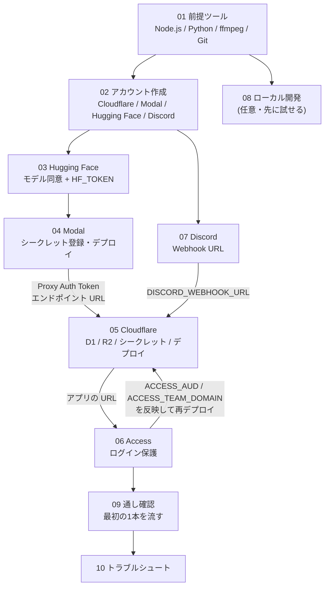

# セットアップ手順書

このアプリを自分の環境で動かすまでの手順を、**ボタン単位**で説明します。初めての方でも、上から順に進めれば完成するように書いています。

> ⚠️ **外部サービスの画面は変わることがあります。** 画面の文言は 2026年11月時点の想定です。表記が違う場合は、近い名前の項目を探してください。各ファイルに公式ドキュメントのリンクを付けています。

## 全体の流れ

**図の読み方**: 矢印は「この手順で得た値を、次の手順で使う」という依存関係です。`06 Access` で得た値を `05 Cloudflare` の設定に戻して**再デプロイ**する点に注意してください。

## 作業順チェックリスト

| ☐ | 手順 | ファイル | 所要時間の目安 |
|---|---|---|---|
| ☐ | 前提ツールを入れる | [01-prerequisites.md](01-prerequisites.md) | 15〜30分 |
| ☐ | 各サービスのアカウントを作る | [02-accounts.md](02-accounts.md) | 20〜40分 |
| ☐ | Hugging Face でモデルに同意しトークンを作る | [03-huggingface.md](03-huggingface.md) | 10分 |
| ☐ | Modal をセットアップ・デプロイする | [04-modal.md](04-modal.md) | 20〜40分(初回の画像作成は数分〜十数分) |
| ☐ | Discord の Webhook を作る | [07-discord.md](07-discord.md) | 5分 |
| ☐ | Cloudflare を設定しデプロイする | [05-cloudflare.md](05-cloudflare.md) | 30〜60分 |
| ☐ | Access でログインを保護する | [06-access.md](06-access.md) | 20〜30分 |
| ☐ | 通し確認(最初の1本) | [09-verification.md](09-verification.md) | 30分〜(音声の長さによる) |
| ☐ | (任意)ローカルで動かす | [08-local-dev.md](08-local-dev.md) | 15分 |
| - | うまくいかないとき | [10-troubleshooting.md](10-troubleshooting.md) | - |

ファイル番号は「読む順」ではなく「見つけやすさ」の番号です。**作業はこの表の順**で進めてください(`07 Discord` は `05` の前に済ませます)。

## 必要なアカウントとツール

| 種類 | 名前 | 用途 | 費用の目安 |
|---|---|---|---|
| アカウント | Cloudflare | Worker・D1・R2・Access | 無料枠あり(R2 の有効化にカード登録を求められる場合あり) |
| アカウント | Modal | GPU での文字起こし | 毎月の無料クレジットあり(カード要否は登録画面で確認) |
| アカウント | Hugging Face | 話者分離モデルの取得 | 無料 |
| アカウント | Discord | 完了通知 | 無料 |
| ツール | Node.js 22 以上 | Worker・画面のビルド | 無料 |
| ツール | Python 3 | Modal の CLI | 無料 |
| ツール | ffmpeg | テスト・ローカル確認 | 無料 |
| ツール | Git | ソースの取得 | 無料 |

## 手順書の読み方

各ステップは次の形で書かれています。

- **やること**: 操作の手順。**太字**は画面に表示されている文言です。
- ✅ **正常な場合**: こうなっていれば成功。
- ❌ **異常な場合**: よくあるエラーと対処。
- 📝 **控える値**: 後の手順で使う値。**実際の値はこの手順書に書かず、手元のメモ(パスワード管理ツールなど)に控えてください。**

## 控える値の一覧(どこで得て、どこで使うか)

| 値 | 得る手順 | 使う手順 | 使い道 |
|---|---|---|---|
| `HF_TOKEN` | 03 | 04 | Modal のシークレット |
| `CALLBACK_SECRET` | 04 | 04, 05 | Modal と Worker で**同じ値** |
| Modal の `MODAL_KEY` / `MODAL_SECRET` | 04 | 05 | Worker のシークレット |
| Modal のエンドポイント URL | 04 | 05 | `wrangler.jsonc` の `MODAL_ENDPOINT_URL` |
| `DISCORD_WEBHOOK_URL` | 07 | 05 | Worker のシークレット |
| Cloudflare のアカウント ID | 05 | 05 | `R2_ACCOUNT_ID` |
| D1 の `database_id` | 05 | 05 | `wrangler.jsonc` |
| R2 の `R2_ACCESS_KEY_ID` / `R2_SECRET_ACCESS_KEY` | 05 | 05 | Worker のシークレット |
| アプリのホスト名 | 05 | 05, 06 | `APP_URL`、CORS、Access |
| `ACCESS_AUD` / `ACCESS_TEAM_DOMAIN` | 06 | 05(再デプロイ) | JWT 検証 |

## 設計を知りたくなったら

仕組みの解説は [../architecture/README.md](../architecture/README.md) にあります。

## 次に読むファイル

- [01-prerequisites.md](01-prerequisites.md)
